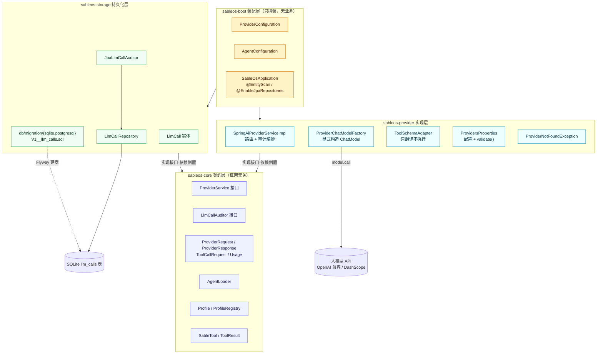
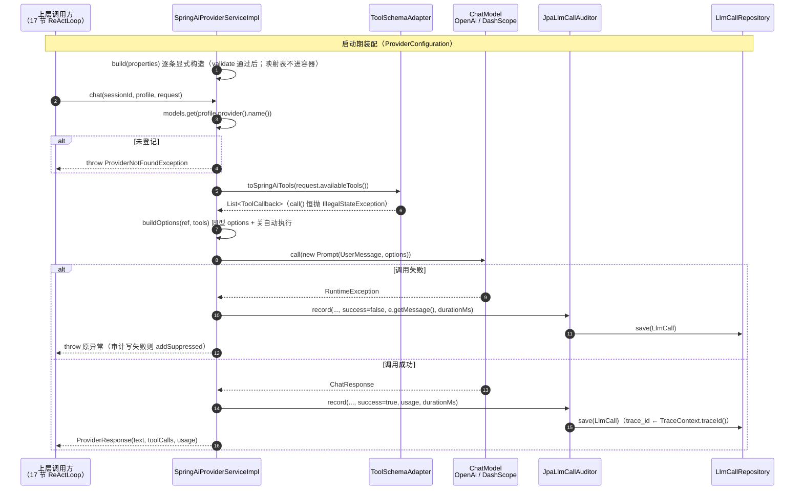

# 第 16 节 · Agent Provider 代码走读（面向新成员）

> **范围**：当前分支 `001-lesson16-provider` 相对 `main` 的全部改动（merge-base `17e2cfc`，6 个提交，48 个文件）。  
> **读法**：本文只讲「为什么这样分层、数据怎么流、哪些地方最容易踩错」，不逐行复述代码。读完对着 §4 的两张图，再回看 §2 的「必看」清单即可上手。  
> **验收基线**：`mvn clean verify` 全绿（130 tests，四层质量门禁）。

---

## 1. 本次新增/变更功能概述

本节把「**一次大模型调用**」封装成一条**可路由、可审计、绝不自作主张**的薄通道，是 Agent OS 五大核心能力中的第一个（对接 LLM）。

业务目标有三个现实约束：**多家模型并存**（不同 Agent 用不同家）、**模型随时可换**（不锁厂商，改配置不碰代码）、**每次调用可审计**（花了多少 token、失败为什么）。落地上新增了四样东西：

- **Agent 定义加载**：`AgentLoader` 扫描工作区 `.sableos/agents/<name>/AGENT.md`，把 frontmatter 派生成 `Profile`（一个目录 = 一个 Agent），注册进内存索引 `ProfileRegistry`；单个定义损坏只记日志跳过，**不阻断启动**。
- **统一模型调用入口**：`ProviderService.chat(sessionId, profile, request)` —— 按 `profile.provider().name()` **显式路由**到对应 `ChatModel`，发起一次调用，把文本与「想调工具」的请求原样返回。
- **调用审计**：每次调用不论成败都往 `llm_calls` 表落一条记录（provider / model / token 用量 / 耗时 / success / 失败原因 / traceId）。
- **工具说明翻译**：`ToolSchemaAdapter` 把 `SableTool` 翻译成所选模型协议的 schema，**只翻译、绝不执行**——执行权留给上层的 ToolExecutor。

**用户可见的变化**：配置多写一段 `sableos.providers` 即可在同一实例接入多家模型；改 Agent 的 model/provider 只改 `AGENT.md`、代码零改动；审计员事后可查任意一次调用的完整要素。本节的直接下游消费者是第 17 节的 ReAct 循环。

---

## 2. 关键实现步骤（按执行顺序）

| # | 环节                            | 文件 / 模块                                                                                                                                                                                                                                              | 职责                            | 为什么必须看                                                                                                                                 | 阅读建议                                                                                                                       |
| - | ----------------------------- | ---------------------------------------------------------------------------------------------------------------------------------------------------------------------------------------------------------------------------------------------------- | ----------------------------- | -------------------------------------------------------------------------------------------------------------------------------------- | -------------------------------------------------------------------------------------------------------------------------- |
| 1 | **依赖与配置面准备**                  | 根 `pom.xml`（surefire 排除 `integration`）、`sableos-core/pom.xml`（+snakeyaml/jackson）、`sableos-provider/pom.xml`（+spring-ai-openai / dashscope starter / spring-retry）、`application.yaml`（`spring.ai.dashscope.enabled=false` + `sableos.providers: []`） | 锁定编译与运行时前提                    | `dashscope.enabled=false` 是本节最反直觉的一步：DashScope starter 的 10 个 autoconfig 默认全激活、无 key 即启动失败，用**单个属性**整体关闭                               | ⚠️ 可略过细节，但**必须知道**「为什么禁 dashscope 自动装配」                                                                                    |
| 2 | **契约层落地**                     | `sableos-core/.../provider/`（`ProviderService`、`LlmCallAuditor`、`ProviderRequest`/`ProviderResponse`/`ToolCallRequest`/`Usage`）、`.../tool/`（`SableTool`、`ToolResult`）                                                                                | 定义框架无关的接口与中立 DTO              | 这是全节**依赖倒置的支点**：接口在 core、实现在 provider。第 17 节 ReActLoop 住在 core 要调 `ProviderService`，接口若留在 provider 就会形成 core→provider 的环（Maven 直接拒绝构建） | **必看**：`ProviderService` + `LlmCallAuditor` 两个接口签名（其余 DTO 扫签名即可）                                                           |
| 3 | **Profile 与 Agent 加载**        | `sableos-core/.../profile/`（`Profile`、`ProfileRegistry`）、`.../agent/AgentLoader.java`                                                                                                                                                                | 扫描 AGENT.md → 派生 Profile → 注册 | 这里是「一个目录 = 一个 Agent」的落地，也是本节唯一读文件/解析 YAML 的地方，坑最集中（校验、坏目录不阻断）                                                                          | **必看**：`deriveProfile` 的校验块 + `loadAll` 的 catch 分段                                                                         |
| 4 | **存储栈：审计落库**                  | `sableos-storage/.../LlmCall.java`、`LlmCallRepository`、`JpaLlmCallAuditor`、`db/migration/{sqlite,postgresql}/V1__llm_calls.sql`                                                                                                                      | 建表（Flyway 双轨）+ 成败两态写入         | 「审计 day one 落库」是项目宪法原则 VI；`trace_id` 取 `TraceContext.traceId()`，**禁 `UUID.randomUUID()`**                                              | **必看**：`JpaLlmCallAuditor.record()`（traceId 来源 + fail-closed）；SQL 与 `LlmCall` 实体扫一眼即可                                      |
| 5 | **Provider 实现：工厂 + 适配器 + 服务** | `sableos-provider/.../ProviderChatModelFactory.java`、`ToolSchemaAdapter.java`、`SpringAiProviderServiceImpl.java`、`ProvidersProperties.java`、`ProviderNotFoundException.java`                                                                         | 显式构造 ChatModel、翻译工具、路由 + 编排审计 | 本节**心脏**。所有「不许自动执行工具」「不许类型扫描」「失败也要留痕」的硬约束都在这里落钉                                                                                        | **必看**：`SpringAiProviderServiceImpl.chat()` 的 try/catch 编排 + `buildOptions` 两个 builder 分支；`ProviderChatModelFactory` 的显式构造 |
| 6 | **启动装配**                      | `sableos-boot/.../provider/ProviderConfiguration.java`、`.../agent/AgentConfiguration.java`、`SableOsApplication.java`                                                                                                                                 | 校验 → 构造 → `new`，把各件拼起来        | 只有装配、没有业务。注意 **ChatModel 映射不注册为 bean**（避免容器里多个 ChatModel 分不清谁是谁）                                                                       | **必看**：`ProviderConfiguration` 的 3 个 `@Bean` 顺序                                                                            |
| 7 | **测试与验收**                     | 7 个测试类（见 §5 表格）                                                                                                                                                                                                                                      | 三个课件关键回归 + 装配/存储/冒烟           | 三个回归测试是本节不可弱化的验收钉子                                                                                                                     | 精读 `ProviderServiceTest` 的 3 个关键方法；其余可略过                                                                                   |

**机械件（扫签名即可）**：core 的中立 DTO record、`ProfileRegistry`、`LlmCall`（JPA 样板）、`LlmCallRepository`、两条 `V1__llm_calls.sql`、`AgentConfiguration`。

---

## 3. 调用链路说明（入口 → 结果）

### 3.1 启动期链路（装配顺序）

```text
Spring Boot 启动
 ① ProvidersProperties 绑定 application.yaml 的 sableos.providers  （空清单合法、零 key 可启动）
 ② ProviderConfiguration.providerService(...)
      2a. properties.validate()            违规即点名报错、启动失败（快失败）
      2b. ProviderChatModelFactory.build() 逐条显式构造 ChatModel；★不注册为 bean
      2c. new SpringAiProviderServiceImpl(路由表, properties, adapter, auditor)
 ③ AgentConfiguration
      3a. agentLoader（agentsDir=.sableos/agents，knownProviders=清单名字集）
      3b. profileRegistry = loadAll()      坏目录只记日志跳过，不阻断启动
 ④ storage 栈： Flyway 跑 db/migration/sqlite/V1__llm_calls.sql → 建 llm_calls 表
 ⑤ LlmCallAuditor ← new JpaLlmCallAuditor(LlmCallRepository)  审计通道就位
```

### 3.2 运行期链路（一次 `chat()`）

```text
上层调用方（17 节 ReActLoop / 未来的 CLI、Web）
   │  chat(sessionId, profile, request)
   ▼
SpringAiProviderServiceImpl（sableos-provider）
   │ ① 路由：profile.provider().name() 查内部路由表 Map<String,ChatModel>
   │      查不到 → throw ProviderNotFoundException   ◀── 坑一：不降级、不换家、不留空
   │ ② 翻译：ToolSchemaAdapter.toSpringAiTools(request.availableTools())
   │      SableTool → ToolCallback；产物 call() 恒抛        ◀── US3：只翻译不执行
   │ ③ 选型：buildOptions 按 provider type 造「同型」options
   │      openai→OpenAiChatOptions.Builder / dashscope→DashScopeChatOptions.builder()
   │      内嵌 internalToolExecutionEnabled(false)          ◀── 坑二：显式关自动执行
   │ ④ 调用：model.call(new Prompt(List.of(new UserMessage(content)), options))
   │      ────▶ Spring AI (OpenAiChatModel / DashScopeChatModel) ────▶ 大模型 API
   │ ⑤ 映射：content / toolCalls(原样) / usage(null 安全)
   │
   ├── 失败路径：先 auditor.record(..., success=false, e.getMessage(), 耗时)
   │            审计自身也失败？→ LOG.error + e.addSuppressed(auditError) → 原异常照抛
   │
   └── 成功路径：auditor.record(..., success=true, usage, 耗时)
                审计失败？→ LOG.error，照常返回业务结果（fail-open）
   ▼
JpaLlmCallAuditor（sableos-storage）
   │ trace_id ← TraceContext.traceId()（无链路上下文 = null；禁 UUID.randomUUID）
   ▼
LlmCallRepository.save(LlmCall) → SQLite llm_calls 表（成败各一条）
```

### 3.3 模块依赖与数据流转

- **依赖方向（单向、无环）**：`provider → core` ｜ `storage → core` ｜ `boot → 全部三者`。
- **契约倒置**：接口 + 中立 DTO 在 core、Spring AI 实现在 provider；core **不染任何 Spring / Spring AI 类型**（DTO 全是 JDK 的 `record`）。
- **数据流**：`AGENT.md`(frontmatter) → `Profile` → `Profile.ProviderRef.name` → 路由表 → `ChatModel` → `ChatResponse` → `ProviderResponse` + `LlmCall`（落库）→ 调用方。
- **traceId 流**：`TraceContext`（web/CLI 入口开作用域）→ MDC 日志 → 响应信封 → `JpaLlmCallAuditor` 写入 `llm_calls.trace_id`，四者同一 ID。

---

## 4. 架构图与调用图

### 4.1 架构图（模块与分层）



### 4.2 调用图（方法/函数级）



### 4.3 架构设计与设计取舍

- **分层与依赖倒置（核心取舍）**：契约放 core、实现放 provider。技术方案 §10 字面上「ProviderService 归 provider 模块」若照抄，会让住在 core 的 ReActLoop 反向依赖 provider 形成环。本仓库沿用 §8.5 `ScheduledTaskStore` 的既有先例，把接口与中立 DTO 提到 core，core 保持**框架无关**（不出现 Spring AI 类型）——这也是第 17 节能写纯单测的前提。代价：core 多了 `snakeyaml` / `jackson-databind` 两个依赖。
- **显式映射（宪法 IV）**：`ProviderChatModelFactory` 遍历清单逐条 `new`，**零类型扫描**；`ChatModel` 映射**不注册为 Spring bean**，只作为 `ProviderService` 内部路由表——从根上杜绝「容器里多个 ChatModel 分不清谁是谁」。
- **自动执行双重关闭（宪法 III）**：`defaultOptions` 与 per-call `options` 两处都设 `internalToolExecutionEnabled(false)`（belt & braces）；`ToolSchemaAdapter` 的 `call()` 恒抛，即使防御失效也会显性失败而非静默跑工具。这是「同一个工具被调两次」这类事故的钉子。
- **审计语义**：`LlmCallAuditor` 实现 **fail-closed**（写库失败上抛 `IllegalStateException`），但编排层对两种路径区别对待——**失败路径以原异常为准**（审计写失败走 `addSuppressed`，不遮蔽真因），**成功路径 fail-open**（审计写抖动不许否决一次已完成的真实调用）。成功记录**移出 try 块**，消除了「成功记录自身抛异常→坠入 catch 再补一条失败记录」的双写窗口。
- **扩展点**：`SableTool` 抽象让内置 / Plugin / MCP 三类工具对上层无差别（第 20 节接入）；`ProviderService` 是第 17 节 ReActLoop 的唯一注入点；`Profile` 预留了 tools/channels/schedules 等字段供后续节消费。


- **潜在风险**：契约是「单轮最小形」（见 §5）——多轮 ReAct 需要演进时可能回改公共接口；`error_message` 依赖 `e.getMessage()`，为 null 时审计原因缺失。

---

## 5. 遗留问题

**A. 契约按「最小形」交付，多轮适配需演进**

- `ProviderRequest(content, availableTools)` 只有**单轮用户输入**，没有 message 列表 / system prompt 载体。第 17 节 ReAct 循环需要把 system 提示与「工具结果」回填进请求，届时要扩展此 DTO（属已知设计取舍 research D-07，非缺陷，但**新成员改这里要意识到会动公共接口**）。

**B. 审计要素的完整性缺口**

- `llm_calls.model` 记的是 **Profile 声明值**，不是供应商响应里返回的实际 model；若供应商做了别名映射，审计与真实落点可能不符。
- 失败原因只记 `e.getMessage()`，**为 null 时（如 NPE）审计的失败原因为空**，与成功标准 SC-002「失败记录 100% 带原因」有张力；同样未记异常堆栈。
- 未记 `cost_micros`（成本）、`profile_name`（画像名）；`LlmCallRepository` 只有 JPA 基础方法，**没有查询接口**（完整审计查询属扩展阶段）。

**C. 加载与运行期的限制**

- `AgentLoader` 只在**启动期**加载一次，无运行期热加载 / 动态注册（属第 29 节）。
- `agentsDir` 用相对路径 `.sableos/agents`，**受进程工作目录影响**；换工作目录跑会静默加载为空（有 INFO 日志但不报错）。

**D. 网络策略为硬编码常量**

- base-url 归一（去尾 `/` 与 `/v1`）、连接 10s / 读取 120s、单次重试（`maxAttempts=1`）都是常量，**未升格为配置键**；归一策略只覆盖这两种常见后缀写法，非标准端点需确认。

**E. 明确的「不做」边界（本节范围内）**

- 不含：ReAct 循环、工具的真正执行、fallback / 熔断 / hedge racing、流式响应、成本聚合看板、多租户。这些都是后续节的内容，不要在本节代码里找。

**F. 测试覆盖的现实约束**

- `ProviderSmokeIT` 打 `@Tag("integration")`，**默认被 surefire 排除**，需真 key + 手动 `-Dgroups=integration` 触发；零 key 环境只验证「装配可启动」，**不验证真实连通**。
- `trace_id` 在 core 无链路上下文时写入为 **null**（有列但可空），线上排障时若审计行缺 traceId，属预期内表现而非 bug。

**建议的后续优化优先级**：① 审计补 `e.getMessage()` 为空的兜底（写异常类名）；② `error_message` 记为声明 model 与响应 model 的差异留痕；③ 把超时/base-url 归一提为配置键；④ 为 `LlmCallRepository` 补按 sessionId/traceId 的查询方法，供第 26 节管理平台使用。
