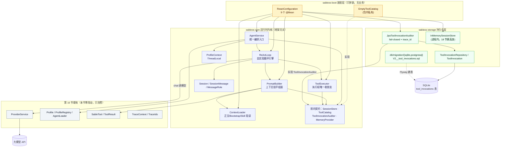
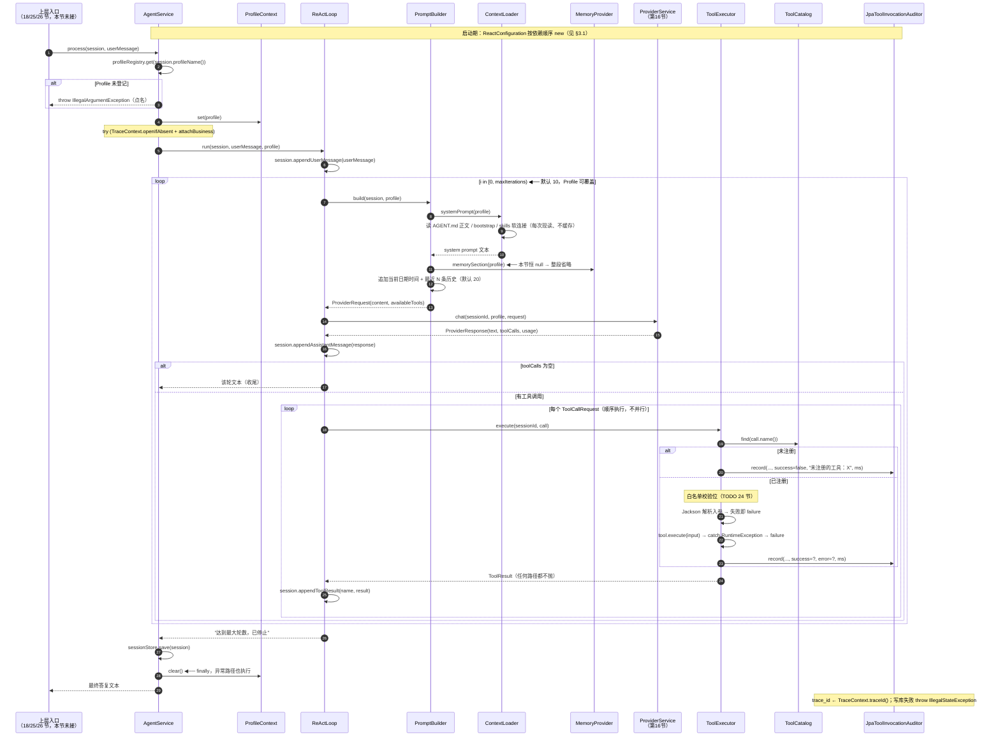

# 第 17 节 · ReAct 循环代码走读（面向新成员）

> **范围**：当前分支 `002-lesson17-react` 相对 `main` 的全部改动（merge-base `3d84851`，3 个提交，53 个文件，+4203/−27）。  
> **提交链**：`a2728d1`（Spec-Kit 产物 + 验收报告）→ `f0daf15`（运行时内核实现）→ `ccd75d1`（复盘：宪章引用与悬空引用修复）。  
> **读法**：本文只讲「为什么这样分层、数据怎么流、哪里最容易踩错」，不逐行复述代码。读完对着 §4 的两张图，再回看 §2 的「必看」清单即可上手。  
> **验收基线**：`mvn clean verify` 全绿（163 tests，0 失败，SpotBugs 0 BugInstance）；本节 7 个测试类 / 32 个用例，含 11 个课件关键回归。

---

## 1. 本次新增/变更功能概述

本节交付 Agent OS 五大核心能力中的**第二个：ReAct 循环**——让 Agent 从「问一句答一句的 chatbot」变成「想一步、做一步、看结果，反复循环直到把事办成」。

一句话概括改动：**新增一条自实现的「组装上下文 → 调大模型 → 有工具调用就执行并回填 → 没工具调用就收尾」的循环链，并为它补上统一编排入口、上下文来源加载、工具执行与审计收口**。

核心场景有三类：

- **自主多轮**：用户说「看看今天天气，帮我决定穿什么」→ 第 1 轮模型要求调 `http_get` → 执行并把结果回填 → 第 2 轮模型给出穿搭建议 → 收尾。
- **循环可控**：模型可能反复要求调工具永不收敛。迭代上限（默认 10、可由 Agent 运行配置覆盖）转满即强制收尾，返回固定文案 `达到最大轮数，已停止`；进入模型的上下文只保留**最近 N 条**消息（默认 20），system prompt 永不参与截断。
- **过程留痕**：每轮的模型输出与工具结果都累积进会话历史；每次工具调用不论成败都往 `tool_invocations` 落一条审计（工具名 / 入参 / 结果 / 成败 / 失败原因 / 耗时 / 会话 / traceId）。

**用户可见的变化**：本节**没有独立可演示入口**（对话版 Demo 要等 18 节 CLI 接入 `AgentService.process`）。可见变化全在底座侧——同一实例上新出现了「一个能自己转圈、且转不出圈也会停」的处理能力，且**换模型 / 改迭代上限只改 `AGENT.md` 的运行配置，循环代码零改动**。

---

## 2. 关键实现步骤（按执行顺序）

| #  | 环节            | 文件 / 模块                                                                                                                                                             | 职责                                                                               | 为什么必须看                                                                                                        | 阅读建议                                                                                           |
| -- | ------------- | ------------------------------------------------------------------------------------------------------------------------------------------------------------------- | -------------------------------------------------------------------------------- | ------------------------------------------------------------------------------------------------------------- | ---------------------------------------------------------------------------------------------- |
| 1  | **前向契约落地**    | `sableos-core/.../session/`（`MessageRole`、`SessionMessage`、`Session`、`SessionStore`）、`.../tool/`（`ToolCatalog`、`ToolInvocationAuditor`）、`.../memory/MemoryProvider` | 定义 4 个「本节只用、真实现归后节」的契约                                                           | 这是本节**依赖倒置的支点**：循环住在 core，它需要的「会话累积 / 按名找工具 / 成败审计 / 可选记忆」正式归属分别是 18 / 20 / 20+storage / 22 节。不先定契约，core 内就成环 | **必看**：`Session` 的三种 `append*` 与 `SessionMessage` 的静态工厂（口径最易写歪）；其余接口扫签名                        |
| 2  | **上下文组装**     | `sableos-core/.../prompt/PromptBuilder.java`                                                                                                                        | 按固定顺序把 system prompt + 记忆段 + 最近 N 条历史**拍平成一段文本**                                 | 本节**最容易看错**的一处：多轮历史不是 `message` 列表，而是一整块 `content` 字符串——为的是让第 16 节 `ProviderRequest` 契约**零改动**                | **必看**：`build()` 的 4 段顺序 + `tail()` 的截断公式；`render()` 扫一眼格式                                     |
| 3  | **上下文来源加载**   | `sableos-core/.../context/ContextLoader.java`                                                                                                                       | 读 `AGENT.md` 正文 + `identity.prompt` + Bootstrap 文件 + `skills/` 软连接扫描，**每次现读不缓存** | 「人格悄悄丢了」这类软故障的防线：缺失分两档处理（正文/Bootstrap 缺失记 WARN，Skill 绑定断裂**报错点名**）                                            | **必看**：`systemPrompt()` 的分段顺序、`resolveSkill()` 的越界校验、`stripFrontmatter()`（只剥围栏、不解析 YAML）       |
| 4  | **工具执行与审计收口** | `sableos-core/.../tool/ToolExecutor.java`                                                                                                                           | 按名解析 → 白名单校验位 → 解析入参 → 执行 → 成败两态写审计                                              | **全节唯一允许执行工具的地方**（宪法 III 的落点）。「异常不吞」在这里的定义是**原因留痕 + 不中断循环**，由轮数上限兜底——不是往上抛                                    | **必看**：`execute()` 的三条失败分支（未注册 / 入参非法 / 执行异常）与 `// TODO(24 节)` 那行                              |
| 5  | **循环引擎**      | `sableos-core/.../react/ReActLoop.java`                                                                                                                             | 反复「组装 → 调 Provider → 判断有无工具调用」，有则逐个执行并回填，无则收尾                                    | 本节**心脏**，只有 60 余行但要读懂每一行的取舍                                                                                   | **必看**：`run()` 全文（迭代上限、收尾条件、`MAX_ITERATIONS_REPLY` 常量）                                         |
| 6  | **统一编排入口**    | `sableos-core/.../agent/AgentService.java`、`.../profile/ProfileContext.java`                                                                                        | 取 Profile → 放入线程级上下文 → 跑循环 → 保存会话 → `finally` 清理                                 | 「三种触发源共用同一入口」的落点；线程级上下文不清是「单请求永远测不出、并发复用时串号」的最阴险一类 bug                                                        | **必看**：`process()` 的 `try/finally` 结构 + `openIfAbsent` 复用外层链路的写法                               |
| 7  | **审计落库**      | `sableos-storage/.../ToolInvocation.java`、`ToolInvocationRepository`、`JpaToolInvocationAuditor`、`db/migration/{sqlite,postgresql}/V2__tool_invocations.sql`         | 建表（Flyway 双轨）+ 成败两态写入                                                            | 宪法原则 VI「审计 day one 落库」；`trace_id` 取 `TraceContext.traceId()`，**禁 `UUID.randomUUID()`**                        | **必看**：`JpaToolInvocationAuditor.record()` 的 traceId 来源与 fail-closed；实体 / SQL / Repository 扫一眼 |
| 8  | **进程内会话存储**   | `sableos-storage/.../InMemorySessionStore.java`                                                                                                                     | `Map<String, Session>`，本节只保证「处理完成后会话被保存」                                         | 跨重启持久化归 18 节。看到它要知道这是**有意的最小实现**，不是漏做                                                                         | 扫一遍即可（20 行左右）                                                                                  |
| 9  | **启动装配**      | `sableos-boot/.../react/ReactConfiguration.java`                                                                                                                    | 把 9 个组件接成一条链；三处前向契约给本节最小实现                                                       | 只有装配、没有业务。注意 **`ToolCatalog` 是「空实现」**（任何工具调用都按未注册失败）、**`MemoryProvider` 返回 null 的 lambda**——这是三处显式占位          | **必看**：9 个 `@Bean` 的**定义顺序**（依赖关系一目了然）+ `EmptyToolCatalog`                                     |
| 10 | **测试与验收**     | 7 个测试类（见 §5 表）                                                                                                                                                      | 11 个课件关键回归                                                                       | 回归测试是本节不可弱化的验收钉子；方法名英文、`@DisplayName` 保留课件中文                                                                  | 精读 `ReActLoopTest` / `ToolExecutorTest` / `AgentServiceTest` 的关键方法；其余可略过                       |

**机械件（扫签名即可）**：`MessageRole` 枚举、`SessionStore` / `ToolCatalog` / `ToolInvocationAuditor` / `MemoryProvider` 四个接口、`ToolInvocation`（JPA 样板）、`ToolInvocationRepository`、`InMemorySessionStore`、两条 `V2__tool_invocations.sql`。

---

## 3. 调用链路说明（入口 → 结果）

### 3.1 启动期链路（装配顺序）

```text
Spring Boot 启动
 ① ReactConfiguration（sableos-boot）——按依赖顺序建 9 个 bean：
      toolInvocationAuditor ← new JpaToolInvocationAuditor(ToolInvocationRepository)
      sessionStore          ← new InMemorySessionStore()          ★本节最小实现
      toolCatalog           ← new EmptyToolCatalog()               ★本节最小实现（无工具）
      memoryProvider        ← profile -> null                      ★本节最小实现（无记忆）
      contextLoader         ← new ContextLoader(.sableos/agents, .sableos, .sableos/skills)
      promptBuilder         ← (contextLoader, toolCatalog, memoryProvider)
      toolExecutor          ← (toolCatalog, toolInvocationAuditor)
      reActLoop             ← (providerService, promptBuilder, toolExecutor)
      agentService          ← (profileRegistry, reActLoop, sessionStore)
      ★ 不新增第二个 TaskDecorator（全容器只允许 ObservabilityConfig 那一个）
 ② Flyway 跑迁移：
      V1__llm_calls.sql       （16 节）       → llm_calls 表
      V2__tool_invocations.sql（本节）        → tool_invocations 表 + 2 个索引
 ③ profileRegistry 由 16 节 AgentConfiguration 提供（.sableos/agents/<name>/AGENT.md → Profile）
```

### 3.2 运行期链路（一次 `process()`）

```text
上层调用方（18 节 CLI / 26 节 Web / 25 节定时 —— 本节尚无入口）
   │  agentService.process(session, userMessage)
   ▼
AgentService（sableos-core）
   │ ① profileRegistry.get(session.profileName())
   │      查不到 → throw IllegalArgumentException 点名 profile 名   ◀── 不静默、不兜底
   │ ② ProfileContext.set(profile)                                   ◀── 线程级「当前 Agent」
   │ ③ try (TraceContext.openIfAbsent();          ← 外层已开链路则复用，否则新开根链路
   │         TraceContext.attachBusiness(sessionId, profileName, channel))
   │    │
   │    └─▶ ReActLoop.run(session, userMessage, profile)
   │          a) session.appendUserMessage(userMessage)
   │          b) maxIterations = profile.settings().maxIterations()   （默认 10）
   │             for i in [0, maxIterations):
   │               ┌─ PromptBuilder.build(session, profile)
   │               │    ├─ ContextLoader.systemPrompt(profile)   每次现读文件、不缓存
   │               │    │     identity.prompt → AGENT.md 正文 → 各 Bootstrap 文件 → skills 说明
   │               │    ├─ 追加「当前时间：yyyy-MM-dd HH:mm:ss」      ◀── 固定在 system 段末尾
   │               │    ├─ memoryProvider.memorySection(profile)     ← 本节恒 null，整段省略
   │               │    ├─ 最近 N 条历史（默认 20）拍平成一段文本    ◀── 截断只作用于这里
   │               │    └─ toolCatalog.toolsFor(profile)             ← 本节空表
   │               │        ⇒ ProviderRequest(content, availableTools)   ★16 节契约零改动
   │               ├─ providerService.chat(sessionId, profile, request)  ★第 16 节
   │               ├─ session.appendAssistantMessage(response)
   │               ├─ response.toolCalls() 为空？ ──▶ return content     ◀── 正常收尾
   │               └─ 逐个 call：ToolExecutor.execute(sessionId, call)
   │                     ├─ toolCatalog.find(name) == null → failure「未注册的工具：X」
   │                     ├─ ── 白名单校验位（TODO 24 节，本节空位）──
   │                     ├─ Jackson 解析入参失败        → failure「工具入参解析失败：…」
   │                     ├─ tool.execute(input) 抛异常   → failure「工具执行异常：…」
   │                     └─ auditor.record(...) 成败两态
   │                   session.appendToolResult(name, result)
   │             （转满 maxIterations）──▶ return "达到最大轮数，已停止"
   │          c) 返回结果
   │    │
   │    └─ ④ sessionStore.save(session)
   │   finally: ProfileContext.clear()                              ◀── 异常路径也必须清（SC-005）
   ▼
JpaToolInvocationAuditor（sableos-storage）
   │ trace_id ← TraceContext.traceId()（无链路上下文 = null；禁 UUID.randomUUID）
   │ 写库失败 → LOG.error（已 CRLF 净化）+ throw IllegalStateException（fail-closed）
   ▼
ToolInvocationRepository.save(ToolInvocation) → SQLite tool_invocations 表（成败各一条）
```

### 3.3 模块依赖与数据流转

- **依赖方向（单向、无环）**：`core`（无外部框架依赖）← `storage`（实现 core 的审计/会话契约）← `boot`（装配全部）。core **不出现任何 Spring / Spring AI 类型**，这是本节能写纯单测的前提。
- **数据流**：`AGENT.md` + `bootstrap` + `skills/` →（`ContextLoader`）→ system prompt 文本 →（`PromptBuilder`）→ `ProviderRequest.content` →（16 节 `ProviderService`）→ `ProviderResponse` → `Session.messages`（就地累积）→ 下一轮再拍平回 `content`。
- **工件流（审计）**：`ToolResult` →（`ToolExecutor`）→ ① 回填 `SessionMessage(TOOL)` ② `tool_invocations` 一行（含 `session_id` 与 `trace_id`）。
- **traceId 流**：`AgentService` 开作用域 → MDC 日志 → `llm_calls.trace_id`（16 节）+ `tool_invocations.trace_id`（本节），三处同一 ID。

---

## 4. 架构图与调用图

### 4.1 架构图（模块与分层）




### 4.2 调用图（方法级）



### 4.3 架构设计与设计取舍

- **依赖倒置 + 前向契约（本节最大的架构动作）**：循环住在 core，它需要「会话累积 / 按名找工具 / 成败审计 / 可选记忆」四样能力，而它们的正式归属是 18 / 20 / 20+storage / 22 节。解法是**先在 core 定契约**（`SessionStore`、`ToolCatalog`、`ToolInvocationAuditor`、`MemoryProvider`），本节给最小实现（内存会话 / 空工具目录 / JPA 审计 / 返回 null 的记忆）。收益：core 保持框架无关、循环可写纯单测（mock 四个契约）；代价：core 里多了 4 个「暂无真实消费者」的接口，需要新成员理解这是**有意的依赖倒置**而非过度设计。
- **多轮上下文「拍平成一段文本」（research D-02）**：没有引入 core 自己的 `Message` 体系，而是把历史渲染成 `User: … / Assistant: … / Tool[x]: …` 拼进 `ProviderRequest.content`，工具仍走原生 `availableTools` schema。**取舍点**：换来第 16 节 Provider 契约零改动（不改前序节公共接口），代价是丢失结构化角色信息，将来接真实多轮 message 列表时要演进这个 DTO。
- **执行权唯一收敛（宪法 III）**：`SableTool.execute` 只被 `ToolExecutor` 调用；`ToolExecutor.execute` **任何路径都返回 `ToolResult`、不向上抛**——未注册 / 入参非法 / 执行异常一律收敛为失败结果回填，循环据此继续、由轮数上限兜底。这里「异常不吞」的定义是**原因必须留痕于结果与审计**，而不是把异常抛给调用方。
- **线程级上下文用 `ThreadLocal` 而非 `ScopedValue`**：JDK 21 下 `ScopedValue` 仍是 preview，开 `--enable-preview` 会挂构建；同时**故意不用 `InheritableThreadLocal`**（跨线程要么显式传、要么不传），配合「每请求独占一虚拟线程」的前提天然不串台。`AgentService` 用 `try/finally` 保证异常路径也 `clear()`。
- **截断只作用于历史**：`PromptBuilder.tail()` 只截会话历史（默认 20 条，一条消息计一轮），system prompt 与记忆段**永不参与截断**——保证人格与当前用户消息不会因上下文变长而丢失。
- **审计 fail-closed**：`JpaToolInvocationAuditor` 写库失败即抛 `IllegalStateException`，绝不静默丢审计（定位「私有可审计」是产品本身）。
- **潜在风险**：① `ToolCatalog.find(name)` **不带 Profile 参数**，多 Agent 工具集不同时按名解析可能解析到当前 Agent 不该见的工具——真实现归 20 节，落地时必须在此收口；② 每轮都重新读文件（`ContextLoader`）换「改文件立即生效」，高频调用下有磁盘 IO 开销；③ 上下文靠「最近 N 条」顶住，**中间段会被静默丢弃**（无压缩，属明确不做）。
- **扩展点**：`ToolCatalog` / `MemoryProvider` / `SessionStore` 三个接口就是 20 / 22 / 18 节的插入点；`ToolExecutor` 里那行 `// TODO(24 节)` 是沙箱的接线处；`AgentService` 是三种触发源（18 / 25 / 26 节）的唯一入口。

---

## 5. 遗留问题

### A. 三处「前向契约的本节最小实现」（有意占位，非缺陷）

- `ToolCatalog` → `EmptyToolCatalog`：本节**没有任何真实工具**，模型要求调工具一律按「未注册」失败。真实现（`ToolRegistry` + 三档接入）归 20 节。
- `MemoryProvider` → `profile -> null`：长期记忆注入归 22 节，`PromptBuilder` 对 null/空白整段省略。
- `SessionStore` → `InMemorySessionStore`：**跨重启即丢**。`sessions` 表 + 恢复 + 状态机归 18 节 `SessionManager`。

### B. 沙箱是「空位」

- `ToolExecutor` 里白名单校验只有一行注释（`// TODO(24 节)`），**本节涉外 IO 无任何沙箱约束**。`Sandbox` 接口五件归 20 节、`WhitelistSandbox` 实现归 24 节。**新成员注意：绝不要把「有校验位」误读成「已受保护」。**

### C. 上下文与契约的演进压力

- `ProviderRequest` 仍是**单轮最小形**（一段 `content` + 工具 schema）。多轮上下文靠文本拍平顶住，丢失结构化角色信息；将来若要接真实 message 列表 / 上下文压缩 / 流式输出，**会动到第 16 节的公共 DTO**。
- 历史截断是「只留最近 N 条」的硬切，**中段被静默丢弃**，长对话下可能丢关键信息；上下文压缩属明确不做。

### D. 工具解析的粒度风险

- `ToolCatalog.find(String)` 不带 `Profile`，`toolsFor(Profile)` 才按 Profile 过滤。两者口径不一致，20 节落地真实注册表时需保证「模型只能看见、也只能调到自己可见的工具」。

### E. 入口与可演示性缺口

- 本节**没有独立入口**，`AgentService.process` 目前无生产调用方（CLI 归 18 节、Web 归 26 节、定时归 25 节），对话版 Demo 需等 18 节。当前端到端只能靠单测桩（mock `ProviderService`）。
- `trace_id` 在 CLI / 定时入口（18 / 25 节）接入前可能写入 **null**（有列、可空），线上排障时审计行缺 traceId 属预期内表现，非 bug。

### F. 加载与路径的现实约束

- `ContextLoader` 构造参数用相对路径（`.sableos/agents` 等），**受进程工作目录影响**；换目录运行会静默加载为空（正文缺失只记 WARN、不报错）。
- `AGENT.md` 缺失只 WARN 跳过（尊重「坏文件不阻断」），但**显式绑定的 Skill 软连接断裂会报错点名**——两档处理是刻意的，别统一。

### G. 测试覆盖的现实约束

- 五个核心单测类**零网络**（全 mock）；`ToolInvocationRepositoryTest`（真 Flyway + 临时 SQLite）与 `ReactAssemblyTest`（零 key 装配）走 `@SpringBootTest`；集成冒烟打 `@Tag("integration")` **CI 默认跳过**。
- 剩余人工项（真模型冒烟、本地起服务、审计表肉眼抽查）见 `specs/002-lesson17-react/acceptance-report.md` §三。

**建议的后续优化优先级**：① 20 节落地 `ToolRegistry` 时统一 `find` 的 Profile 口径；② 18 节把 `sessions` 表与 `session_id` 拼装单点化（当前 `session_id` 由调用方传入，尚未收口到 `SessionManager`）；③ 评估把「拍平文本」演进为结构化 message 列表的时机（越晚改，回改面越大）；④ 24 节接线沙箱时，把校验位从注释变成真实调用并补回归测试。
