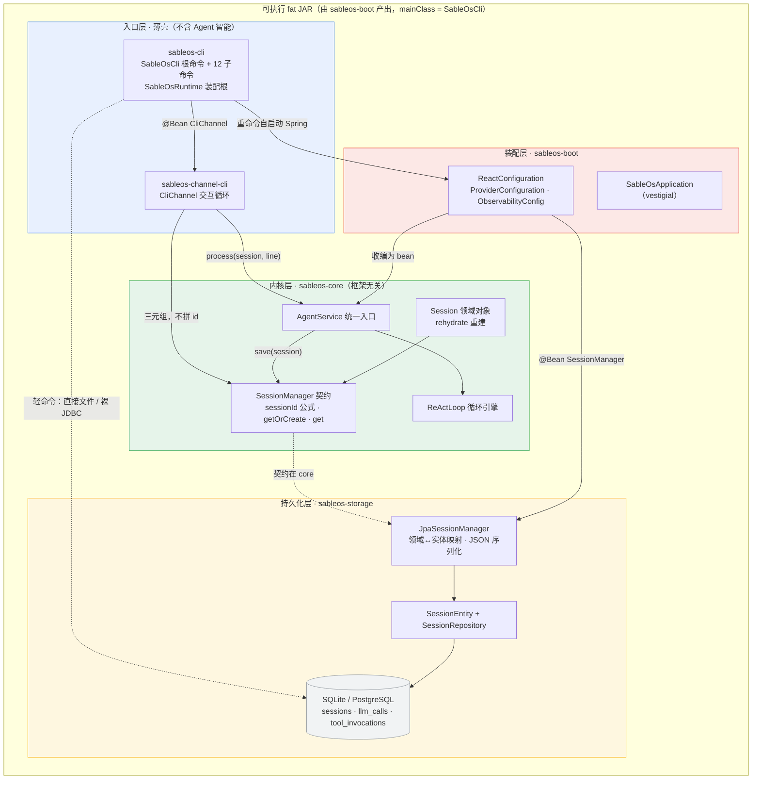
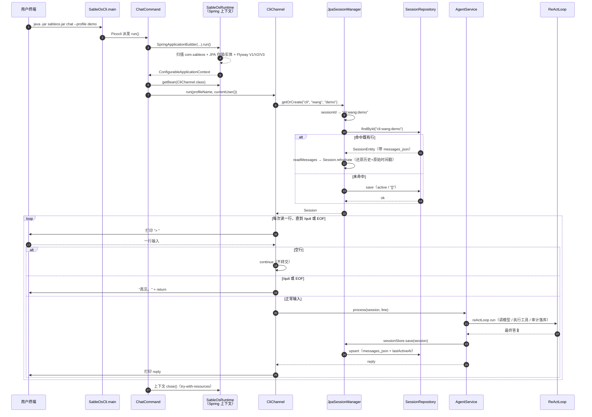

# 第 18 节 · CLI 与会话持久化代码走读（面向新成员）

> **范围**：当前分支 `003-lesson18-cli` 相对 `main`（merge-base `bec9b06`）的全部改动。目前**尚未提交**，全部在工作区：已跟踪文件 11 个改动（+140/−52，含删除 `InMemorySessionStore`），新增文件 34 个（代码 22 个 + Spec-Kit 产物 12 份）。  
> **读法**：本文只讲「为什么这样分层、数据怎么流、哪里最容易踩错」，不逐行复述代码。读完对着 §4 的两张图，再回看 §2 的「必看」清单即可上手。  
> **验收基线**：`mvn clean verify` 全绿（core 91 · provider 21 · channel-cli 2 · web 33 · storage 13 · boot 12）；课件 harness 两个测试类全绿；fat JAR `java -jar` 实证冒烟通过（详见 `specs/003-lesson18-cli/acceptance-report.md`）。  
> **一句话定位**：第 16 节让底座「会调模型」，第 17 节让它「会思考」，本节给它装**一扇门（CLI）**&#x548C;**一份记忆（会话持久化）**——大脑第一次能在终端里被人亲手操作。

---

## 1. 本次新增/变更功能概述

本节做两件事：**把底座包成可执行 JAR 的命令行入口**，以及**把第 17 节的进程内会话存储升级成跨重启持久化的 JPA 实现**。

业务目标是让「人」第一次能直接用这套 Agent OS：开发者敲 `sableos chat` 就能在终端里跟自己定义的 Agent 多轮对话，运维可以把底座当作常驻服务/守护进程跑起来，任何人都能用「看一眼就退」的命令秒查工程状态、有哪些 Agent / Provider / 工具 / 会话。命令按**轻/重分流**——轻命令（init/status/profile/provider list/tool list/session list）完全不启动 Spring、直接读写文件与裸 JDBC，0.5 秒内返回；只有重命令（chat/serve/gateway）才启动应用上下文。同时，会话从「进程一退就没了」变成「写进 SQLite `sessions` 表、重启后历史完整回来」，且会话的身份（session_id）被钉死在一处公式 `channel:user:profile` 上，杜绝「同一个人裂成两条互不相认的历史」。

**用户可见的变化**：`java -jar sableos.jar chat --profile <name>` 进入交互式对话（`/quit` 或 Ctrl-D 退出）、`init` 建出 `.sableos/` 骨架、`status` 报工作区与 Agent 计数、`session list` 列出历史会话；`serve` 与 `gateway` **只登记了命令外壳**——与 chat 一样先起 `SableOsRuntime` 上下文（`serve`/`gateway` 用 `WebApplicationType.SERVLET`，故会真的占用 8080 端口并常驻，Ctrl-C 退出），打印占位文案后不返回；完整实现分别归 26 节与后续渠道节。不可见但最关键的变化在底座侧：会话持久化取代了内存存储，17 节的 `InMemorySessionStore` 被删除，`AgentService` 的保存路径一行未改。

---


## 2. 关键实现步骤（按执行顺序）

| # | 环节                  | 文件 / 模块                                                                                                                             | 职责                                                                                                                                | 为什么必须看                                                                                                                                                         | 阅读建议                                                                                                                                                                      |
| - | ------------------- | ----------------------------------------------------------------------------------------------------------------------------------- | --------------------------------------------------------------------------------------------------------------------------------- | -------------------------------------------------------------------------------------------------------------------------------------------------------------- | ------------------------------------------------------------------------------------------------------------------------------------------------------------------------- |
| 1 | **core 会话契约**       | `sableos-core/.../session/SessionManager.java`（新增）、`Session.java`（改）                                                                | `SessionManager extends SessionStore`，新增 `sessionId()` / `getOrCreate()` / `get()`；`Session` 追加 `rehydrate()` 静态工厂                | **全节地基**。三点必须看懂：①`extends SessionStore` 是**追加式**，`AgentService` 签名零改动；②`sessionId` 是全代码库唯一拼接处（不变量 H4④）；③`rehydrate` 解决「既有构造把 createdAt 钉成 now、历史钉空」无法还原持久化态的问题 | **必看**：`sessionId()` 3 行 + `Session.rehydrate()` 的 8 个入参；`Session` 其余 getter/`append*` 未变，扫签名即可                                                                           |
| 2 | **持久化三件套**          | `sableos-storage/.../SessionEntity.java`、`SessionRepository.java`、`db/migration/{sqlite,postgresql}/V3__sessions.sql`（均新增）          | JPA 实体（9 列）+ 仓储接口 + Flyway 双轨建表脚本                                                                                                 | 表结构唯一权威是**迁移脚本**（禁 `ddl-auto`）；`session_id` 是**非自增字符串主键**——由契约生成后写入，不是数据库生成的。命名 `SessionEntity` 是为避开 core 的领域类 `Session`                                       | **必看**：`SessionEntity` 的 `@Id` 无 `@GeneratedValue` 那行 + 两条 SQL 的 9 列对照；Repository 是 1 行空接口，可略过                                                                            |
| 3 | **JPA 实现（本节心脏）**    | `sableos-storage/.../JpaSessionManager.java`（新增）                                                                                    | `SessionManager` 的落地：`getOrCreate` / `get` / `save`，并负责领域 `Session` ↔ `SessionEntity` 映射                                          | **本节最该精读的类**。三个关键取舍：①命中既有行走 `rehydrate` 还原历史与原始时间戳；②`messages_json` 整体 JSON 存单列（核心阶段不按条拆表）；③`save` 做成 **upsert**（命中更新易变列、未命中补全整行）——比 oryxos 的「未命中即抛」更健壮        | **必看**：`getOrCreate()` 与 `save()` 全文（见 §2.1 带读）；`restore/writeMessages/readMessages` 三个私有方法扫一眼                                                                            |
| 4 | **取代内存存储**          | 删 `InMemorySessionStore.java`；改 `sableos-boot/.../react/ReactConfiguration.java`、`sableos-boot/src/test/.../ReactAssemblyTest.java` | `sessionStore()` bean → `sessionManager(SessionRepository)`，返回 `JpaSessionManager`；测试断言同步改为 `JpaSessionManager`                   | 因为 `SessionManager` is-a `SessionStore`，**`agentService(..., SessionStore)` 注入一行没改**——这是 `extends` 换来的零破坏。17 节 8 个 bean 断言与 process 落库断言均未动                    | **必看**：`ReactConfiguration` 那 3 行改动 + 测试断言那 1 行；理解「为什么不用改 AgentService」                                                                                                   |
| 5 | **chat 交互通道**       | `sableos-channel-cli/.../CliChannel.java`（新增）                                                                                       | 读 stdin → 交引擎 → 打印 stdout → `/quit`/EOF 退出                                                                                        | **「CLI 是门不是干活的人」这句话的落点**。全文 80 行、零 Agent 智能、零框架依赖，自带可注入 stdin/stdout 的重载方法供纯单测。退出判定是 CLI 唯一「自己判断」的逻辑                                                           | **必看**：`run()` 的 while 循环（见 §2.2 带读）；`stdinReader()`（有 console 用 console，否则跟 JVM 默认编码）可略过                                                                                 |
| 6 | **装配根（本节最大的坑）**     | `sableos-cli/.../SableOsRuntime.java`（新增）                                                                                           | `@SpringBootApplication(scanBasePackages="com.sableos")` + `@EnableJpaRepositories` + `@EntityScan` + `CliChannel` bean           | **踩坑点**：`scanBasePackages` 只管普通 Bean，**不会带动 JPA 仓储/实体扫描**跟着跨模块。存储在独立的 `com.sableos.storage`，不显式声明就会「Found 0 JPA repository interfaces」、审计与会话静默写不进、启动即退出        | **必看**：三个注解（见 §2.3 带读）+ 理解「为什么这两个注解全仓只此一处」                                                                                                                                |
| 7 | **12 个子命令 + 轻/重分流** | `sableos-cli/.../SableOsCli.java`（改）+ `command/` 下 9 个命令类 + 2 个辅助类（新增）                                                              | 根命令挂 9 个 `@Command`，展开为 12 个子命令；重命令自启动 Spring，轻命令纯文件/裸 JDBC                                                                       | **分流判据只有一条**：这个命令要不要调模型/跑引擎。`session list` 要读库但不跑引擎 → 归轻命令，用 `DriverManager` 裸 JDBC 直读，不为只读列表起 4 秒上下文                                                          | **必看**：`SableOsCli` 的 `subcommands` 清单 + `ChatCommand.run()`；`ServeCommand`/`GatewayCommand` 只需看「`web(SERVLET)` + 不套 try-with-resources」这两点；其余 6 个轻命令类**可略过**（都是十几行的文件操作） |
| 8 | **boot 收敛 + 主类改指**  | `sableos-boot/pom.xml`、`SableOsApplication.java`（改）、3 个 boot 测试类（改）                                                                 | fat JAR `mainClass` 改指 `SableOsCli`；`SableOsApplication` 剥掉 JPA 扫描降为 vestigial；boot 的 `@SpringBootTest` 改指 `SableOsRuntime.class` | **模块边界的关键一笔**：boot 仍是 fat JAR 产出方（AGENTS.md 口径不变），cli 升为聚合入口，依赖方向保持 `boot → cli` **单向无环**。JPA 扫描挪走是为了避免两个应用类重复注册仓库                                             | **必看**：`SableOsApplication` 删掉的两行 + pom 的 5 行 + 测试类 `@SpringBootTest(classes=...)` 那一行                                                                                    |
| 9 | **测试（harness 判卷）**  | `SessionManagerTest`（4 例）、`SessionRepositoryTest`（3 例）、`CliChannelTest`（2 例）                                                        | 真 Flyway + 临时 SQLite；幂等 / 隔离 / id 公式 / JSON 回读 / 模拟重启；薄壳转交与退出                                                                     | 课件 harness 只钉**会话层**（这是唯一被自动判卷的部分）。注意 `restart_newContext_historyPersists` 用「新建 `JpaSessionManager` 重查」模拟重启，并先以裸 SQL 证明物理落库（绕开 JPA 一级缓存）                       | **必看**：`SessionRepositoryTest` 的 `restart_newContext_historyPersists` 与 `messagesJson_roundTrips_allFields`；其余可略过                                                         |

**机械件（扫签名即可，不必精读）**：`SessionRepository`（空接口）、两条 `V3__sessions.sql`、`Workspace.java`（工作区路径解析，默认 `.sableos`，可用 `WORKSPACE_ROOT` 覆盖）、`LightDbConfig.java`（轻命令裸 JDBC 连接）、`InitCommand` / `StatusCommand` / `ToolListCommand` / `ServeCommand` / `GatewayCommand`。

---

### 2.1 带读：`JpaSessionManager` 的两个核心方法

**`getOrCreate` —— 幂等的落点**（`sableos-storage/.../JpaSessionManager.java`）：

```java
public Session getOrCreate(String channel, String userId, String profileName) {
  String id = SessionManager.sessionId(channel, userId, profileName);   // ① 唯一拼接处
  Optional<SessionEntity> existing = repository.findById(id);
  if (existing.isPresent()) {
    return restore(existing.get());                                      // ② 命中 → 带历史还原
  }
  SessionEntity entity = new SessionEntity();                            // ③ 未命中 → 建 active 空历史行
  entity.setSessionId(id);
  entity.setProfileName(profileName);
  entity.setChannel(channel);
  entity.setUserId(userId);
  entity.setStatus("active");
  entity.setMessagesJson("[]");
  Instant now = Instant.now();
  entity.setCreatedAt(now);
  entity.setLastActiveAt(now);
  repository.save(entity);
  return restore(entity);                                                // ④ 返回态与持久态一致
}
```

四个点值得停一下：

- **①** 这里**只调用** `SessionManager.sessionId(...)`，绝不自己拼 `":"`。全代码库 `grep '":"'` 应只有这一处实现。
- **②** 幂等的本质：同一三元组永远收敛到同一个 `id`，第二次 `findById` 必命中，所以「多轮对话串得起来」是自然结果，不需要任何额外同步。
- **③** `status` 核心阶段固定 `active`（归档状态机不在本节）。
- **④** 新建后同样走 `restore()`，避免「返回的 Session」与「库里的行」时间戳不一致（`SessionEntity` 另有 `@PrePersist fillDefaults()` 兜底）。

**`save` —— 为什么做成 upsert**：

```java
public void save(Session session) {
  SessionEntity entity = repository.findById(session.id()).orElse(null);
  if (entity == null) {                                  // 未命中 → 从 Session 补全整行
    entity = new SessionEntity();
    entity.setSessionId(session.id());
    entity.setProfileName(session.profileName());
    entity.setChannel(orEmpty(session.channel()));       // core Session 允许 null，落库前 coalesce 成空串
    entity.setUserId(orEmpty(session.userId()));
    entity.setCreatedAt(session.createdAt());
  }
  entity.setMessagesJson(writeMessages(session.messages()));  // 历史整体序列化
  entity.setStatus(session.status());
  entity.setLastActiveAt(session.lastActiveAt());
  repository.save(entity);
}
```

brother 仓库 oryxos 在这里是「未命中即抛异常（save 前必须先 getOrCreate）」，因为它那边的 `Session` 是瘦的（只有 id/profileName/messages），补全不了整行。sableos 的富 `Session` 自带 channel/userId/createdAt，所以做成 **upsert** 更健壮——`AgentService.process` 的保存路径无需强制先 `getOrCreate`，第 17 节里直接 `new Session(id, ...)` 的调用方（如 `ReactAssemblyTest`）也不会被打断。另外注意 `writeMessages` 序列化失败是**显式抛 `IllegalStateException`** 而不是静默存空——历史写不进去等于会话丢失，这种失败必须响。

### 2.2 带读：`CliChannel.run` —— 「门」的全部内容

```java
void run(String profileName, String userId, BufferedReader in, PrintStream out) {
  Session session = sessionManager.getOrCreate(TraceContext.CHANNEL_CLI, userId, profileName);
  out.printf("已连接 Agent [%s]，输入 %s 退出。%n", profileName, QUIT);
  while (true) {
    out.print("> ");
    String line = readLine(in);
    if (line == null || QUIT.equals(line.trim())) {   // EOF 或 /quit → 退出（trim 后再判，容忍前后空白）
      out.println("再见。");
      return;
    }
    if (line.isBlank()) {
      continue;                                        // 空行跳过，不转交引擎
    }
    String reply = agentService.process(session, line); // ★ 交给引擎，CLI 到此撒手
    out.println(reply);
  }
}
```

读这段代码只要抓住三件事：**会话在循环外取一次**（所以同一次对话的连续多行复用同一个 session，多轮上下文才串得起来）；**`/quit` 与 EOF 等价退出**（管道喂完就自然结束，不抛堆栈）；**整段没有任何模型调用与工具执行**——想、调模型、执行工具全在 `AgentService` → `ReActLoop` 里。channel 字面量 `"cli"` 只是作为三元组的一个参数传进去，session_id 拼接发生在 `SessionManager` 内部。

### 2.3 带读：`SableOsRuntime` —— 三个注解缺一不可

```java
@SpringBootApplication(scanBasePackages = "com.sableos")        // ① 收编 boot 的既有 @Configuration
@EnableJpaRepositories(basePackages = "com.sableos.storage")     // ② 仓储扫描（跨模块，必须显式）
@EntityScan(basePackages = "com.sableos.storage")                // ③ 实体扫描（跨模块，必须显式）
public class SableOsRuntime {
  @Bean
  public CliChannel cliChannel(AgentService agentService, SessionManager sessionManager) {
    return new CliChannel(agentService, sessionManager);
  }
}
```

① 在运行期（fat JAR 含各模块）扫到 boot 的 `ReactConfiguration` / `ProviderConfiguration` / `AgentConfiguration` / `ObservabilityConfig`，所以 `SessionManager`、`AgentService` 这些 bean 不用在 cli 里再声明一遍——cli **不依赖 boot**，是 boot 依赖 cli，运行时靠包路径扫描汇合。②③ 是本节最实在的一个坑：**组件扫描和 JPA 扫描是两套独立逻辑**，后者默认只按主类所在包扫，跨模块不声明就是「Found 0 repository」。也正因为如此，`SableOsApplication` 必须把这两个注解剥掉——两处都声明会重复注册仓库。

---

## 3. 调用链路说明（入口 → 结果）

### 3.1 启动期链路：`java -jar` → 命令就绪

```text
java -jar sableos.jar <cmd>            （fat JAR Start-Class = com.sableos.cli.SableOsCli）
  │
  ├─ SableOsCli.main(args)             纯 Picocli，此时完全没有 Spring
  │    └─ new CommandLine(new SableOsCli()).execute(args)
  │         └─ Picocli 按 @Command/subcommands 解析，派发到某个子命令的 run()
  │
  ├─ 【轻命令分支】init / status / profile×4 / provider list / tool list / session list
  │    直接 java.nio.file 读写 .sableos/，或 DriverManager 裸 JDBC 读 sessions 表 → 秒回 → System.exit
  │
  └─ 【重命令分支】chat / serve / gateway —— 三者同源，都在 run() 内自启动同一个装配根
       ChatCommand.run()                       ServeCommand.run() / GatewayCommand.run()
         └─ new SpringApplicationBuilder(SableOsRuntime.class)
                .web(WebApplicationType.NONE)            .web(WebApplicationType.SERVLET)
                .bannerMode(OFF).run()                   .run()          ← 起上下文后打印占位
              ├─ 组件扫描 com.sableos → boot 的 ReactConfiguration 等 @Configuration 被收编
              ├─ @EnableJpaRepositories/@EntityScan("com.sableos.storage") → 注册 3 个 Repository
              ├─ Flyway → V1 llm_calls、V2 tool_invocations、V3 sessions（SQLite 默认档）
              └─ SableOsRuntime.cliChannel(AgentService, SessionManager) → new CliChannel(...)
                 然后 chat 进交互循环、退出即 close()    然后打印占位 → keepAlive() 阻塞常驻
```

注意 `ChatCommand.run()` 用 **try-with-resources** 包住上下文：对话结束（`/quit`/EOF）时 `close()` 自动关掉，进程干净退出。`serve`/`gateway` **刻意不套** try-with-resources——服务/守护进程要一直活着，所以起完上下文后不返回。

**这里有个反直觉的坑**：光"不关上下文"并不足以让进程活着。`SableOsCli.main` 末尾是 `System.exit(new CommandLine(...).execute(args))`，**`run()` 一返回整机就退**——实测打印占位后约 50ms 就走到 `GracefulShutdown`，Tomcat 的非守护线程顶不住一次 `System.exit`。所以 `ServeCommand`/`GatewayCommand` 在最后调 `ServeCommand.keepAlive()`（`new CountDownLatch(1).await()`）把自己堵住，Ctrl-C 再由 Spring 注册的关闭钩子优雅收场（对齐 oryxos `ServeCommand.keepAlive()`）。这就是「重命令都先起上下文（FR-002）、chat 与 serve/gateway 只在**起完上下文后做什么**上分叉」的完整落点。

### 3.2 运行期链路：一问一答（chat 的核心数据流）

```text
① CliChannel.run(profileName, userId)
     └─ sessionManager.getOrCreate("cli", user, profile)
          ├─ id = SessionManager.sessionId("cli", user, profile)   →  "cli:wang:default"
          ├─ repository.findById(id) 命中? ── 是 ─→ Session.rehydrate(...)（带历史+原始时间戳）
          └─                          否 ──→ insert 一行 active/[] ─→ restore 返回

② 循环：out.print("> ") → readLine(stdin)
     ├─ null(EOF) 或 trim()=="/quit"  → 打印"再见。" → return（上下文随之关闭）
     ├─ isBlank()                     → continue（不惊动引擎）
     └─ 否则 → agentService.process(session, line)

③ AgentService.process（17 节代码，本节零改动）
     ├─ profileRegistry.get(session.profileName())      未登记则抛「未注册的 Agent：xxx」
     ├─ ProfileContext.set(profile) + TraceContext.openIfAbsent/attachBusiness
     ├─ reActLoop.run(session, userMessage, profile)    ← 想 / 调模型 / 执行工具都在这里
     │    └─ PromptBuilder 组装 → ProviderService 调 LLM → 有 toolCalls 则 ToolExecutor 执行并回填
     ├─ sessionStore.save(session)   ★ 运行期注入的即 JpaSessionManager（is-a SessionStore）
     │    └─ messages 整体 JSON → messages_json；lastActiveAt → now；upsert 到 sessions 表
     └─ finally: ProfileContext.clear()

④ CliChannel 拿到 reply → out.println(reply) → 回到 ② 等下一行
```

**数据流转要点**：三元组（channel/user/profile）是**唯一输入**，session_id 由契约单点生成；会话的真相在 `sessions.messages_json` 一列里；`AgentService` 全程只认 core 的 `SessionStore` 接口，它不知道持久化换成了 JPA——这正是依赖倒置的收益。三种运行模式（chat/serve/gateway）共享同一份 Profile 与同一套会话存储，切换模式数据不丢。

### 3.3 轻命令链路（以 `session list` 为例）

```text
SableOsCli.main → SessionListCommand.ListCommand.run()
  └─ LightDbConfig.sqliteFileMissing()?  是 → 打印"暂无会话（…尚未创建，首次 chat 时生成）" → return
  └─ LightDbConfig.connect()  →  DriverManager.getConnection("jdbc:sqlite:" + Workspace.dbFile() + "?busy_timeout=5000")
       └─ SELECT session_id, profile_name, status, last_active_at FROM sessions ORDER BY last_active_at DESC
```

零 Spring、零 JPA、零引擎——只为「列个表」而启动 4 秒上下文是不划算的。

---

## 4. 架构图与调用图

### 4.1 架构图（模块与分层关系）



### 4.2 调用图（方法级，chat 一次完整交互）



### 4.3 架构设计与设计取舍（读图后必读）

**分层：为什么 `SessionManager` 契约在 core、实现在 storage？**  
这是本仓既定的依赖倒置先例（沿用 §28 `ScheduledTaskStore` 的做法，见 research D-01）。core 保持框架无关，`AgentService` 只认 `SessionStore`；持久化实现换 JPA 时上层一行不改。附带一个关键收益：**session_id 公式随契约落在 core**，严丝合缝满足 AGENTS.md 不变量 H4④「core 侧单点拼接」——如果把 `SessionManager` 整个放 storage，公式就落到持久化层，与不变量字面冲突。

**扩展点：三个已经预留好的口子**

1. **新渠道**：新增 web / scheduler 渠道时，只需传各自的三元组（`web:u:profile`、`scheduler:digest:profile`），`CliChannel` 这一套「读—转交—打印」模式可直接复制，session_id 公式无需改动。
2. **新命令**：往 `SableOsCli.subcommands` 加一个 `@Command` 类即可。判断轻/重的标准只有一条——要不要调模型/跑引擎。
3. **会话归档**：`status` 与 `archived_at` 列已就位，但核心阶段固定 `active`，状态机的完整流转留给后续节。

**设计取舍（有意为之，不是遗漏）**

| 取舍                                   | 选择                                                    | 代价                                       |
| ------------------------------------ | ----------------------------------------------------- | ---------------------------------------- |
| `SessionManager` 与 `SessionStore` 关系 | `extends`（追加式）而非并列或改 `AgentService` 依赖类型              | 接口上多继承一层，但换来 `AgentService` 与 17 节测试零改动  |
| 历史存储形态                               | `messages_json` 整体 JSON 单列                            | 单条消息无法按条件查询/分页；长会话整行读写，见 §5 遗留问题         |
| `save` 语义                            | upsert（未命中则补全整行插入）而非抛异常                               | 比 oryxos 宽松；若调用方传了不完整的 Session 也会插进去     |
| 程序入口                                 | fat JAR 仍由 boot 产出，只把 `mainClass` 改指 cli；cli 不依赖 boot | `SableOsApplication` 沦为 vestigial，新成员易困惑 |
| 轻命令 `session list`                   | 裸 JDBC 直读 SQLite                                      | 数据源解析与 Spring 侧是两套逻辑，见 §5 遗留问题           |

**潜在风险（改动时最容易踩的雷）**

- **JPA 扫描声明**：`@EnableJpaRepositories`/`@EntityScan` 全仓**只此一处**。谁要是给 `SableOsApplication` 加回去，就是重复注册；谁要是在别处新建第二个装配根而忘了这两个注解，就是「Found 0 repository」+ 审计静默不写——这类故障不报明显错误，查起来很痛。
- **session_id 拼接**：任何入口都不要自己拼 `":"`。两处各拼一遍、格式差一个分隔符，同一个人就会出现两条互不相认的历史。收尾靠 `grep '":"' --include=*.java` 核验。
- **空输入与退出**：`/quit` 判定要先 `trim()`；EOF 必须与 `/quit` 等价处理，否则脚本化喂输入时会抛堆栈。

---

## 5. 遗留问题

**未完成的功能（按 spec 边界有意留白）**

1. `serve` / `gateway` 只有命令外壳：起 `SERVLET` 上下文（因此已占 8080 端口、进程常驻）后打印占位文案，不实现任何 REST 端点与多通道挂载。完整 Web Service 归 26 节，多通道守护进程归后续渠道节。两者同时运行会争 8080 端口（契约既定形态，接 26 节时按需拆端口配置）。
2. `tool list` 永远报「当前无工具登记」——工具注册表 `ToolRegistry`/`ToolCatalog` 归 20 节，且轻命令不启动引擎，无法枚举运行期工具表。
3. 会话状态核心阶段固定 `active`；`archived_at` 列已建但从不写入，归档状态机的完整流转未做。
4. 会话按条拆表（`session_messages`）明确不做；第 13 个子命令 `agent import` 归 25 节。

**需注意的实现约束与风险**

1. **`getOrCreate` 存在 TOCTOU 竞态**：实现是「`findById` → 未命中则 `insert`」，两个进程/线程对同一三元组并发首次获取时，可能同时走到 insert，后者撞主键冲突（`DataIntegrityViolationException`）。spec 的 Edge Case 明确要求「并发下须收敛到同一会话」，当前靠「SQLite 主键约束 + 后到者报错」兜底，不是优雅收敛。多入口（web/scheduler）真正并发起来之前需要处理（如 `save` 失败后回查一次，或数据库层 upsert）。
2. **轻命令的数据源解析与 Spring 侧是两套逻辑**：`LightDbConfig` 直接用 `Workspace.dbFile()`（默认 `.sableos/sableos.db`，支持 `WORKSPACE_ROOT` 覆盖），**并不读 `application.yaml` 的 `spring.datasource.url`**。一旦改成 PostgreSQL 或改了库路径，`session list` 仍会去读默认的 SQLite 文件，看到空/旧数据。任务书原本规划的是「读配置 url + `${ENV:default}` 占位」，实现做了简化——这是真实漂移风险，后续要么统一配置源，要么在文档里把这条约束写明。
3. **`messages_json` 单列 JSON 的规模化问题**：历史越长，每次 `save` 都要整行读出、追加、整行写回；单条消息的检索/统计/分页无从下手。长会话场景需要评估拆表或压缩/归档策略。
4. **`ProfileCommand delete` 会递归删除整个目录**（`Files.walk` + 逐个 delete）。已有 `requireSafeName` 拒绝路径分隔符与 `..`、且需要显式 `--yes`，风险可控，但仍是不可逆操作，后续建议改为移入回收站式备份。
5. **`ChatCommand` 没有 `--user` 选项**，用户标识取 `System.getProperty("user.name")`。核心阶段无认证体系，这是有意的；接多租户/SSO 时这条要重做。
6. **`SableOsApplication` 已降为 vestigial**：它的 `main` 不再是 fat JAR 入口（入口是 `SableOsCli`），且它不再声明 JPA 扫描。留着它是为了 AGENTS.md「boot 产出 fat JAR」的口径与 boot 测试的最小载体，但新成员极易误以为它是启动类，建议在文件头注释之外、在 AGENTS.md 里也点一句。
7. **`serve`/`gateway` 的常驻依赖 `keepAlive()`，与 `main` 的 `System.exit` 强耦合**：`SableOsCli.main` 一律 `System.exit(execute(args))`，故任何"要常驻"的命令都必须自己把 `run()` 堵住（现为 `ServeCommand.keepAlive()` 的 `CountDownLatch`）——**光"不关上下文"不够**，去掉 `keepAlive()` 进程会秒退。日后若改 `main` 不调 `System.exit`（例如要把退出码透给脚本），这条依赖随之变化，须同步复核。附带一条运维面约束：两者都起 SERVLET 容器、共用 `server.port`（默认 8080），**同时运行会争端口**。

**建议后续优化**

1. **人工验收项尚未过**（详见 `specs/003-lesson18-cli/acceptance-report.md`）：真模型多轮对话（冒烟用的是 EOF 退出 + 未注册 provider，**未跑真实模型推理**）、12 个子命令 `--help` 逐个走查、轻/重启动耗时主观确认。
2. **`CliChannel` 目前无日志**：用户输入直接写 stdout 不经 logger，所以「用户可控字符串入日志前做 CRLF 净化」这条不变量当前不适用；一旦给它加日志（尤其记用户输入），必须按 AGENTS.md §5.2 做 `replaceAll("[\\r\\n]", "_")` 净化。
3. **CI 的 OWASP Dependency-Check**：本地按默认 `-Dowasp.skip=true` 跳过，以 CI 独立 job 为权威门禁（AGENTS.md §5.3）。
4. **交互体验**：oryxos 成熟版有 `/new` 清空会话、打字机流式输出、RBAC 上下文等，本节按边界全部未做（分属 26/19 及后续节）。oryxos 的 `serve` 另有 `--port` 选项，本节按契约未加（端口走 `server.port` / 环境变量）。
