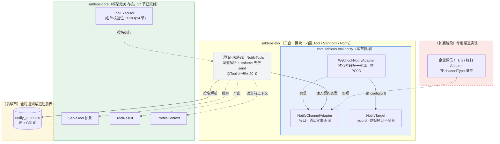
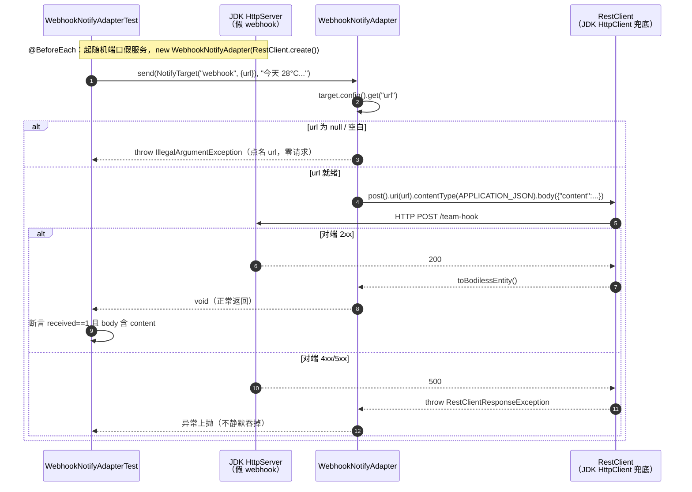

# 第 19 节 · Notify 出站通知代码走读（面向新成员）

> **范围**：当前分支 `004-lesson19-notify` 相对 `main`（merge-base `c6c5b77`＝第 18 节 PR #4 合并点）的全部改动，共 2 个提交（`feefc05` 实现 + `20dea70` 走读笔记）：**改动文件 17 个、+1992 行**。其中**代码仅 5 个文件**（`sableos-tool` 3 个主类 + 1 个测试 + pom，共约 +202 行），`specs/004-lesson19-notify/` 规格 9 份（约 +879 行），`docs/study/` 第 16~18 节走读笔记 3 份（约 +911 行）。
> **读法**：本文只讲「为什么这样分层、数据怎么流、哪里最容易踩错」，不逐行复述代码。读完对着 §4 的两张图，再回看 §2 的「必看」清单即可上手。
> **验收基线**（本次实测）：`mvn -q -pl sableos-tool -am test -Dtest=WebhookNotifyAdapterTest -Dsurefire.failIfNoSpecifiedTests=false` → 4 用例全绿（tests=4 / failures=0 / errors=0 / skipped=0，约 5.3s）；全量门禁 `mvn -q -B clean verify`（Spotless/Checkstyle/P3C-PMD/SpotBugs+FindSecBugs）零告警。注：带 `-am` 会连带构建 core，core 中无同名测试会报 `No tests matching pattern`，故须加 `-Dsurefire.failIfNoSpecifiedTests=false`（或去掉 `-am` 直接 `-pl sableos-tool`）。
> **一句话定位**：第 18 节给底座装了一扇**门（CLI，人推）**；本节补上对称的另一半——一个**出口（Notify，主动推）**：让跑完 ReAct 循环的结果能主动送到人能看到的地方（定时查天气、日报汇总），而不是烂在会话里。

---

## 1. 本次新增/变更功能概述

本节只做一件事：**在 `sableos-tool` 里落一块「出站通知」的地基——`NotifyChannelAdapter` 接口 + `NotifyTarget` 通知目标 + `WebhookNotifyAdapter` 通用 webhook 实现三件套**，并配上第一批验收 harness。

要解决的业务痛点是**链路断开**：CLI 和 Web Service 都是「人推」模式——有人发起、Agent 处理完同步把响应还给发起者，天然不需要推送。可一旦触发源变成「到点自动」（定时查天气、每日新闻汇总），另一端**没有人在等响应**了，Agent 必须主动把结果送到群里/频道里。没有这个抽象，每个业务方都得自己手写「调 http_post 打 webhook」或各配一份 IM 的 MCP server——重复且不统一。Notify 把「往外推一条消息」这件最常见的事**统一成一个出口**，同时它是后续 Memory、Sandbox 会反复用到的「**接口先行**」设计习惯的第一次亮相，也是 25 节定时模块与 31 节 Demo 的出口。

**用户可见的变化：本轮为零——这是有意为之**。notify 三件是**纯 POJO 地基**，既没有 `@Component`、也没注册成工具（`notify` 工具的 `@Tool` 注册归第 20 节 `ToolRegistry` 收编、白名单接线归 23/24 节），所以终端与 Web 端**都没有任何入口能触发它**。本轮唯一「能跑起来的东西」是 `WebhookNotifyAdapterTest`——用 JDK 内置假 webhook 把投递协议钉死。换句话说：**本节交付的是「接口 + 一档实现 + 一份契约」，不是「一个能用的功能」**；能用的功能要等 20/24 节接线后才连得上。

---

## 2. 关键实现步骤（按执行顺序）

| # | 环节 | 文件 / 模块 | 职责 | 为什么必须看 | 阅读建议 |
| - | --- | --- | --- | --- | --- |
| 1 | **依赖口径落地** | `sableos-tool/pom.xml`（改，+10 行） | 新增 `org.springframework:spring-web`（**不带版本**，由父 POM Boot BOM 管理 → 6.2.19）+ `spotbugs-annotations`（`provided`，只为下一处带理由的定点抑制） | **依赖边界的样板**。两个「为什么不」值得记：①**不引 `spring-boot-starter-web` 整包**——只为一个 `RestClient` 拖进 tomcat 一大串；②`spring-web` 是 BOM 内既有构件、**非新第三方**（软门禁「零新增第三方依赖」不触发）。`jackson-databind` 经 `sableos-core` 传递可达，JSON 序列化不用另加依赖 | **必看**：两段 `<dependency>` 与注释；跑一次 `mvn -pl sableos-tool dependency:tree` 看得到 6.2.19 即到位 |
| 2 | **通知抽象①接口** | `sableos-tool/.../notify/NotifyChannelAdapter.java`（新增，18 行） | 「把一条内容送到某个通知目标」这一**意图的唯一表达**：`void send(NotifyTarget target, String content)` | **「接口先行」的落点，全节最该先读的 3 行**。要点在**语汇中立**：签名里不能出现 `webhook`/`url`/`feishu` 等任何一档实现特有的词——这样以后加企业微信官方 SDK 实现时，只新增实现类，**接口不改、调用方不改**（SC-005 人工自查项）。javadoc 还钉死一条语义：**失败必须异常上抛，绝不静默吞掉** | **必看**：整个接口（就一个方法）+ javadoc 那两段 |
| 3 | **通知抽象②通知目标** | `sableos-tool/.../notify/NotifyTarget.java`（新增，17 行） | `record NotifyTarget(String channelType, Map<String,String> config)`：渠道类型 + 一份配置映射 | **读懂「record + 防御拷贝」这个本仓既有约定**。`config` 如何解释由实现类决定（webhook 档取 `config.get("url")`），接口不感知渠道细节。compact 构造做防御拷贝：`null → Map.of()`、否则 `Map.copyOf`——把「实现层拿到的配置不可能被外部改写」变成 record 自己的**不变量**，顺带让缺 url 路径免 NPE。对齐 core `ProviderResponse` 同款先例 | **必看**：compact 构造那 3 行（`config = (config == null) ? Map.of() : Map.copyOf(config);`） |
| 4 | **harness 先行（测试）** | `sableos-tool/src/test/.../notify/WebhookNotifyAdapterTest.java`（新增，112 行） | 用 JDK 内置 `HttpServer` 起**假 webhook**，四条回归：①POST 一次+body 带 content ②地址来自配置非硬编码 ③5xx 上抛 ④缺 url 报错点名零请求 | **本节唯一「能跑起来」的东西，也是理解契约最快的方式**。三个手法值得学：**假 webhook 用 JDK 标准模块 `jdk.httpserver`**（`new InetSocketAddress(0)` 随机端口、真 HTTP，零新第三方依赖，避免引 MockWebServer 扩大 CI 依赖 CVE 扫描面）；**零 Spring 上下文**（`new WebhookNotifyAdapter(RestClient.create())` 直接打本地端口）；**`CopyOnWriteArrayList`** 记录请求（handler 在 HttpServer 工作线程写、测试线程读，免跨线程可见性噪音）。测试方法名英文驼峰、课件中文原文进 `@DisplayName` | **必看**：`@BeforeEach` 起假服务 + 四条测试方法（尤其 ④「零请求」怎么断言）；`startFakeWebhook/record` 等脚手架扫一眼 |
| 5 | **通知抽象③通用实现（本节心脏）** | `sableos-tool/.../notify/WebhookNotifyAdapter.java`（新增，45 行） | 核心阶段**唯一**一档实现：把内容包成 `{"content": ...}` 向 `target.config()["url"]` 发**一次** POST；缺 url 快速失败 | **本节最该精读的类**。两条路径 + 一条纪律：**快速失败**（url 为 null/空白 → 抛 `IllegalArgumentException`，消息点名 `url`、**零请求发出**）、**正常发送**（`post().uri(url).contentType(APPLICATION_JSON).body(Map.of("content", content)).retrieve().toBodilessEntity()`）；**纪律**：url/config 不进日志（地址可能内嵌凭证 token，FR-005）。失败**不注册任何吞错处理器**——4xx/5xx 与连接失败都靠 `RestClient` 默认判定上抛。构造上那处 `@SuppressFBWarnings` 见 §2.1 | **必看**：`send()` 全文（见 §2.1 带读）+ 构造方法上的抑制理由 |
| 6 | **跑绿 + 失败口径收口 + 中立性自查** | 无新文件（T006/T007/T008） | 跑 4 条断言；走查确认「无自定义 ErrorHandler、无 catch 吞错、无降级分支」；`grep` 确认实现内零硬编码地址 | 这是**验收动作**而非新代码，但 T007 的走查结论（「已判定的非成功必抛」靠的是**不写代码**）正是本节的语义核心 | **可略过**（理解 §2.1 的失败语义即可，不必逐项复跑） |
| 7 | **格式化与全量门禁** | 无新文件（T011~T015） | `mvn spotless:apply` → `mvn -q -B clean verify` 全绿 → 前序 16/17/18 节回归 | 例行收口 | **可略过** |

**机械件（扫签名即可，不必精读）**：`sableos-tool/.../package-info.java`（既有文件，本轮未改）、`specs/004-lesson19-notify/` 下 9 份规格文档（`spec.md`/`plan.md`/`research.md`/`data-model.md`/`quickstart.md`/`checklists/`/`contracts/` 两份/`tasks.md`——需要决策背景时再查）、`docs/study/` 第 16~18 节走读笔记（本轮新提交，与本节的代码无关）。

---

### 2.1 带读：`WebhookNotifyAdapter.send` —— 两条路径 + 一条纪律

`sableos-tool/src/main/java/com/sableos/tool/notify/WebhookNotifyAdapter.java`：

```java
public class WebhookNotifyAdapter implements NotifyChannelAdapter {

  private final RestClient restClient;                       // 构造注入：地址由装配层给，测试可指向随机端口

  public WebhookNotifyAdapter(RestClient restClient) {
    this.restClient = restClient;
  }

  @Override
  public void send(NotifyTarget target, String content) {
    String url = target.config().get("url");                 // ① 地址只来自通知目标配置
    if (url == null || url.isBlank()) {
      throw new IllegalArgumentException(                    // ② 快速失败：报错点名 url，零请求
          "webhook 渠道缺少 url 配置（通知渠道注册项需要 url 键）");
    }
    restClient                                              // ③ 正常发送：一次 POST，同步阻塞
        .post()
        .uri(url)
        .contentType(MediaType.APPLICATION_JSON)
        .body(Map.of("content", content))                   //    body 恒为 {"content":"<text>"}
        .retrieve()
        .toBodilessEntity();                                //    body 不消费，只看状态码
  }
}
```

四个点值得停一下：

- **①「地址只来自配置」是 FR-002 的硬约束**，也是 SC-003「换渠道零代码」的全部实现——实现里**没有任何硬编码的域名/路径**，同一套代码喂不同 `config` 就发往不同地址。收尾用 `grep` 核验实现内零硬编码地址。
- **② 快速失败**：缺 url 时不发空 body、不静默跳过，而是**抛出点名 `url` 的 `IllegalArgumentException`**，且**一个字节都不发出去**——「未配置却装作发送成功」和「发了没送到」是同一类必须钉死的软故障。
- **③ 失败口径靠「不写代码」实现**：这里**没有** `try/catch`、**没有**自定义 `ResponseErrorHandler`。4xx/5xx 由 `RestClient` 默认判定抛 `RestClientResponseException`、连接失败抛 `ResourceAccessException`（两者都 `extends RestClientException`）。规范已逐字节码核实默认判定口径：按 HTTP status 的 `hundreds` 位，**仅 4xx/5xx 判 error**。**3xx 默认既不抛也不跟随**（JDK `HttpClient` 默认 `Redirect.NEVER`）——本节不特判、也不声称已管控，重定向出网策略与白名单一起归 23/24 节（这是**有意的留白**，不是漏做）。
- **纪律**：url 与 config **不进日志**（webhook 地址常内嵌 token）。本类因此没有任何用户可控字符串入日志路径——AGENTS.md §5.2 的 CRLF 净化规则在本类**不适用**（但未来给它加日志时就要复核）。

**构造方法上那处 `@SuppressFBWarnings` 是什么？** 存 `RestClient` 字段会被 SpotBugs 判 `EI_EXPOSE_REP2`（"把可变内部表示暴露出去"）。这里做了**方法级定点抑制**并写了完整 justification——理由：`RestClient` 是无状态、线程安全的 HTTP 客户端**抽象（接口）**，构造注入本就是依赖注入「持有协作者引用」，并非暴露可变内部表示；本类无返回该字段的 getter、`send` 只在方法栈内使用。这不是本仓第一次——`PromptBuilder` 存 `ContextLoader` 是同款先例（全仓仅约 3 处定点抑制、**每处都带理由与撤销条件**）。**注意：这道抑制的撤销条件是写在 justification 里的**——一旦本类新增暴露 `restClient` 的 getter、或对它做原地可变配置（换 baseUrl/拦截器），必须重新评估并移除本抑制。

---

## 3. 调用链路说明（入口 → 结果）

### 3.1 本轮可运行链路：harness → 假 webhook（唯一能跑起来的路径）

```text
WebhookNotifyAdapterTest.startFakeWebhook()            @BeforeEach
  ├─ HttpServer.create(new InetSocketAddress(0), 0)    随机端口，零外部依赖
  ├─ server.createContext("/", this::record)           handler：记录 (method, path, body) 到 CopyOnWriteArrayList
  └─ new WebhookNotifyAdapter(RestClient.create())     零 Spring 上下文

测试方法sendPostsJsonBodyContainingContent：
  adapter.send(new NotifyTarget("webhook", Map.of("url", urlOf("/team-hook"))), "今天 28°C，建议短袖")
    └─ WebhookNotifyAdapter.send(target, content)
         ├─ target.config().get("url")               →  "http://127.0.0.1:<port>/team-hook"
         ├─ url 非空 → 继续
         └─ restClient.post().uri(url).contentType(APPLICATION_JSON).body({"content":...})
                .retrieve().toBodilessEntity()
              └─ JDK HttpClient（RestClient 默认兜底实现）→ 真 HTTP POST
                   └─ 假 webhook handler 写 received；回 200（或测试内切 500）
    └─ 断言：received.size()==1 && method=="POST" && body 含 "content" 与原内容

失败路径对照：
  缺 url    → send 内 IAE 上抛，零请求（断言 received 为空）
  对端 500  → RestClient 默认判定抛 RestClientResponseException（断言上抛类型）
```

### 3.2 未来接线后的链路（本轮**不通**，20/24 节接上才成立）

这条链路描述了「Notify 最终长什么样」，**当前代码里跑不通**（`NotifyTools` 还没写、`ToolRegistry` 还没建、`Sandbox` 还没落地），列出来是为了让新成员看清**依赖方向与接线点**：

```text
AgentService.process(session, userMessage)
  └─ ReActLoop.run(...)
       └─ ProviderService 调 LLM → 模型返回 toolCall "notify"
            └─ ToolExecutor.execute(sessionId, call)          【core，17 节已交付】
                 ├─ toolCatalog.find("notify") → NotifyTools  【20 节注册】
                 ├─ TODO(24 节)：Sandbox.enforce(...) 白名单校验位   ← 当前只是注释
                 ├─ NotifyTools.execute(input)
                 │    ├─ 解析 channel（缺省/空白/`default` → 注册表第一个渠道；未注册不回退）   【注册表：后续节】
                 │    ├─ sandbox.enforce(new SandboxAction(HTTP_REQUEST, url))  ← 校验必须先于发送
                 │    └─ adapter.send(target, content)          ← 本节实现的接口，契约类型注入
                 │         └─ WebhookNotifyAdapter.send → POST 到配置地址
                 └─ 成败两态 → tool_invocations 审计表         【既有路径，不新增审计逻辑】
```

**数据流转要点**：本节三件的**依赖方向是单向的**——`WebhookNotifyAdapter` 只依赖 `NotifyTarget` 与 `NotifyChannelAdapter`（同包）+ `spring-web`，**不反向依赖任何上层**；上层（未来的 `NotifyTools`）只认 `NotifyChannelAdapter` 契约类型，感知不到具体是 webhook 还是企业微信实现。**「谁做渠道解析、谁做白名单、谁做投递」被切成三层**：渠道解析与白名单校验在 `NotifyTools`（业务策略层），投递语义在适配器（传输层）——**安全策略不下沉到传输适配器**，这是刻意的分层。

---

## 4. 架构图与调用图

### 4.1 架构图（模块与分层关系）



**实线＝本轮已交付；虚线＝已登记、待后续节接线。**

### 4.2 调用图（方法级，本轮可运行路径）



### 4.3 架构设计与设计取舍（读图后必读）

**分层：为什么适配器只做投递、校验与解析都在上层？** 这是本节最核心的分层判断——把「**渠道解析**（业务策略）」「**白名单校验**（安全策略）」「**投递语义**（传输）」切成三层，**安全策略刻意不下沉到传输适配器**。好处有二：①适配器保持最小职责（发一次 POST），以后加企业微信/飞书实现时不用各自重抄一遍校验；②白名单与 `http_post` **共享同一份机制**（FR-004），统一在上层拦，才不会出现「一个工具拦了、另一个漏了」。代价是本节交付的适配器**自身没有出网管控**——这是**有意留白**，接管点在 `NotifyTools`（24 节）。

**扩展点：三个已经预留好的口子**

1. **新渠道实现**：`implement NotifyChannelAdapter` 即可按 `channelType` 增挂（企业微信/飞书专用 API 把签名、AccessToken 刷新收在实现内）。**接口签名与既有调用方零改动**——这是「接口先行」的全部意义（SC-005）。
2. **通知目标配置**：`NotifyTarget.config` 是一份对上层黑盒的 `Map`，字段如何解释由实现决定；换地址只改运行时配置，**不碰代码、不改对话、不重启**（SC-003）。
3. **工具接线位**：`ToolExecutor` 里已留 `TODO(24 节): Sandbox.enforce(...)` 白名单调用位；`notify` 工具的完整契约已在 `contracts/notify-tool.md` **先定死**（渠道解析规则 + `enforce` 先于 `send` 的顺序不变量），20/24 节照契约落地即可——**契约先行于实现**，正是「接口先行」习惯的第二次体现。

**设计取舍（有意为之，不是遗漏）**

| 取舍 | 选择 | 代价 |
| --- | --- | --- |
| 本轮范围 | 只做「抽象三件 + 第一批 harness」，`NotifyTools` 与第二批 harness **登记不落码** | 本节交付物**无法端到端验证**（未装配、未注册为工具）；好处是避免「做了也接不了线」的双份返工（`@Tool` 归 20 节、`enforce` 归 24 节） |
| 装配方式 | **纯 POJO**（零 `@Component`、零 `@Configuration`） | 本轮 `WebhookNotifyAdapter` 不是 bean、无人构造它；装配统一归 20 节 `ToolRegistry` 收编，避免注解散落各模块 |
| HTTP 客户端 | 引 `spring-web`（BOM 内既有构件）而非 `spring-boot-starter-web` | 需要手动确认 `jackson-databind` 经 core 传递可达（已核实）；换来的是不把 tomcat 拖进来 |
| 失败口径 | 依赖 `RestClient` **默认判定**，不注册吞错处理器 | 语义「藏」在框架默认行为里——所以要靠 research 的字节码核实 + harness ③ 把它钉成显式断言，否则容易被后人「顺手加个 catch」破坏 |
| 3xx 重定向 | 本节**不特判**、不声称已管控 | 当前重定向**未被管控**（默认不跟随，但也不是显式策略）；出网安全策略统一归 23/24 节 |
| `config` 语义 | compact 构造做防御拷贝（`Map.of`/`copyOf`） | record 签名零改地追加了一层不变量；与 core `ProviderResponse` 保持同风格 |

**潜在风险（改动时最容易踩的雷）**

- **别给 `send` 加 catch**：一旦有人在 `WebhookNotifyAdapter.send` 里 `catch (RestClientException e) { log; }` 把异常吞掉，「失败装成功」的软故障就回来了——这是本节反复强调的红线，harness ③ 是它的守卫。
- **别把地址硬编码进实现**：地址**只能**来自 `target.config()`。任何 `config` 之外写死的域名/路径都会让「换渠道零代码」失效，也是本轮 `grep` 自查项。
- **别在日志里打 url/config**：webhook 地址常内嵌凭证 token，打进日志等于泄漏。
- **同步阻塞**：`send` 是一次同步阻塞 POST。上层若在 `synchronized` 块里调用它（或任何 JDBC/LLM/文件/MCP 阻塞调用），JDK 21 会把虚拟线程**钉住**——这类锁要用 `ReentrantLock`（AGENTS.md §5.2）。

---

## 5. 遗留问题

**未完成的功能（按 spec 边界有意留白）**

1. **`NotifyTools` 未实现**（`tasks.md` 的 T009/T010 登记，完成时点 **24 节之后**）：`notify` 工具的渠道解析（缺省/空白/`default` → 注册表第一个；未注册不回退；上下文缺失报错零请求）、`Sandbox.enforce` 先于 `send` 的顺序、以及第二批 harness（`NotifyToolsTest` 三断言 + `InOrder`）全部顺延。契约已定死于 `contracts/notify-tool.md`，实现时照此落地。**这意味着本节没有「用户可用的功能」，也没有端到端验收。**
2. **渠道注册表本体未落地**：`notify_channels` 表 + `/api/v1/notify-channels` CRUD + 管理台随后续节。本节只依赖其「有序 + 按名查找」两条语义，未建表、零迁移。
3. **白名单校验位（FR-004）只是「位置」**：`ToolExecutor` 里留了 `TODO(24 节)` 注释、契约里登记了 `enforce` 顺序，但**当前出网无任何管控**。
4. **3xx 重定向未管控**：默认不跟随（JDK `Redirect.NEVER`），但「禁跟随 + 逐跳复检白名单 + 无 Location 明确报错」整套策略归 23/24 节——本节**不声称已管控**。
5. **专用渠道 API 明确不做**：企业微信/飞书/钉钉的签名算法、AccessToken 刷新留扩展阶段；入站 Channel 与出站 Notify **不合并抽象**（语义方向相反）。

**需注意的实现约束与风险**

1. **未显式配置超时**：`RestClient.create()` 走 spring-web 默认（JDK `HttpClient` 兜底），连接/读取超时沿用框架默认值而未显式设定。对端挂起时可能**长时间占用一个虚拟线程**；接入编排层（20/24 节）前建议显式配置超时。
2. **无重试 / 无幂等键 / 无异步**：本节语义就是「同步阻塞发一次 POST」。定时任务场景下对端抖动即失败（由上层审计为 `success=false`）；重试与幂等交给上层或扩展阶段。
3. **`spotbugs-annotations` 是为一处抑制而引的 `provided` 依赖**：轻量可接受，但要守住「**每处抑制都带 justification + 撤销条件**」的仓库纪律，否则定点抑制会退化成随手 `@SuppressFBWarnings`。
4. **测试保真的边界**：假 webhook 用**真 HTTP**（JDK `HttpServer`），但仍是单测层——它验的是**投递协议**（POST 一次/body/状态码口径），**不验真实 IM 渠道的配置是否正确**。
5. **人工项「接口中立性自查」（SC-005，本轮可做）**：问自己「换成企业微信官方 SDK 实现，`send(NotifyTarget, String)` 签名要改吗？」——结论应为**不需要**。真 webhook 到真实群的验证顺延至 24 节后（依赖 `NotifyTools` 接线）。

**建议后续优化**

1. **接入 20 节时**：`ToolRegistry` 把 `WebhookNotifyAdapter` 装配为 bean（`RestClient` 由装配层提供），与 `NotifyTools` 一起接线；调用方只注入 `NotifyChannelAdapter` 契约类型。
2. **接入 24 节时**：把 `ToolExecutor` 的 `TODO` 落成真 `Sandbox.enforce`，补第二批 harness 的 `InOrder` 顺序断言，并补跑 redirect 系列断言。
3. **27/28 节串联时**：做一次端到端验证（定时触发 → 结果经 `notify` 推到真 webhook），把「协议正确」升级为「配置正确」。
