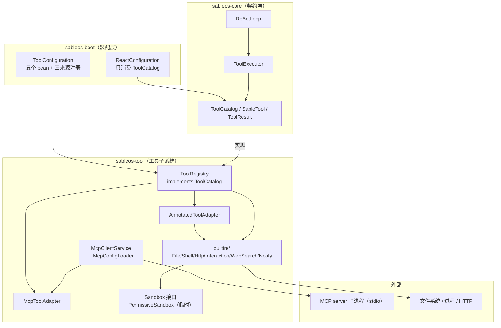

# 第 20 节 Tool 代码走读（新成员版）

> 分支：`005-lesson20-tool`。对应 Spec-Kit 产物：`specs/005-lesson20-tool/`。
> 本文面向第一次接触本仓库的读者：不逐行复述，只讲「改了什么、按什么顺序看、数据怎么流」。

## 1. 本次新增/变更功能概述

本节把第 17 节 ReAct 内核预留的**空工具目录**兑现为真实的工具子系统（FR-007）：模型在 ReAct 循环里调用的工具，现在有了 12 个内置工具（文件读写 / 局部编辑 / grep / glob / shell / HTTP / 用户交互 / 网页搜索 / 通知），并打通了**三条工具接入路径**——直接实现 `SableTool`、`@Tool` 注解、MCP 远程工具——统一汇入一张 `ToolRegistry`，对 ReAct 循环完全透明。同时落地了 `Sandbox` 安全校验的前向接口（当前为临时放行实现 `PermissiveSandbox`，每次放行记 WARN）。用户可见的变化：`sableos tool list` 命令从"暂无工具"变为列出 12 个内置工具；Agent 对话中模型可以真正读写文件、跑命令、搜网页。

## 2. 关键实现步骤（按阅读顺序）

| # | 环节 | 文件/模块 | 职责 | 必看? |
|---|------|-----------|------|-------|
| 1 | 统一注册表 | `sableos-tool/ToolRegistry.java` | 三条来源统一注册为 `SableTool`；重名拒绝而非覆盖；实现 `ToolCatalog` 供 PromptBuilder/ToolExecutor 消费 | **必看**（全节枢纽） |
| 2 | 注解管道适配 | `sableos-tool/AnnotatedToolAdapter.java` | 把 Spring AI 扫出的 `ToolCallback`（schema 自动生成）包成 `SableTool`；只借 schema 与反射，执行发起方仍是 ToolExecutor（宪法 III：禁用框架自动执行） | **必看** |
| 3 | 装配入口 | `sableos-boot/tool/ToolConfiguration.java` | 定义 `Sandbox`、`UserInteraction`、`SearchProvider`、`McpClientService`、`ToolRegistry` 五个 bean；按运行模式（chat / serve）选交互实现 | **必看**（理解全局的入口） |
| 4 | 内置工具面 | `sableos-tool/builtin/`（FileTools、ShellTools、HttpTools、InteractionTools、WebSearchTools、NotifyTools） | 12 个工具本体；硬规矩：每个涉外方法**第一行** `sandbox.enforce(...)`，不过即异常、外部动作零发生 | **必看**：FileTools（范式代表）、ShellTools（超时 + stdout/stderr 并发排空 + 先杀子孙）；可略过：HttpTools、WebSearchTools（同构） |
| 5 | Sandbox 前向接口 | `sableos-tool/sandbox/`（Sandbox / PermissiveSandbox） | 接口先行（技术方案 §6.7）；当前临时放行但每次 WARN 留痕；白名单实现 `WhitelistSandbox` 归 23/24 节，届时只换 bean | **必看**（接口）；可略过：PermissiveSandbox（27 行） |
| 6 | MCP 接入 | `sableos-tool/mcp/`（McpConfigLoader / McpClientService / McpToolAdapter / McpServerConfig） | 读 `.sableos/mcp_servers.yaml`，stdio 起子进程、`tools/list` 拉工具、逐个包成 `SableTool` 注册；**失联不拖垮启动**（单 server 失败只 WARN 跳过） | **必看**：McpClientService、McpToolAdapter；可略过：ConfigLoader（snakeyaml 解析样板） |
| 7 | 交互抽象 | `sableos-tool/interaction/` | `ask_user` 的运行模式分流：CLI 读控制台；Servlet web 无人值守，立刻报"不支持"，绝不堵在服务端 `System.in` | 可略过（看 ToolConfiguration 注释即可） |
| 8 | 既有代码改动 | `boot/react/ReactConfiguration.java`（删 EmptyToolCatalog）、`cli/command/ToolListCommand.java`（静态清单）、`sableos-tool/pom.xml`（新增 spring-ai-model / mcp / snakeyaml） | `ToolCatalog` bean 改由 ToolConfiguration 提供，ReactConfiguration 只消费不定义 | **必看**：ReactConfiguration 的 diff（理解 17 节前向契约如何被替换） |

### 核心代码带读：注册表与注解管道

`ToolRegistry` 的全部要义就两点——重名拒绝、来源无感知：

```java
public void register(SableTool tool) {
  SableTool previous = tools.putIfAbsent(tool.getName(), tool);
  if (previous != null) {
    throw new IllegalStateException("工具重名，拒绝注册: " + tool.getName());
  }
}

/** @Tool 注解来源：schema 由 Spring AI 自动生成，逐方法包装后注册。 */
public void registerAnnotated(Object bean) {
  for (ToolCallback callback : ToolCallbacks.from(bean)) {
    register(new AnnotatedToolAdapter(callback));
  }
}
```

`AnnotatedToolAdapter.execute` 体现"Spring AI 只用一半"的约束——只借它的反射调用，执行权仍在 ToolExecutor：

```java
@Override
public ToolResult execute(JsonNode input) {
  String output = callback.call(input == null ? "{}" : input.toString());
  return ToolResult.success(output); // 异常不捕获：ToolExecutor 统一转失败结果并落审计
}
```

内置工具的安全不变量（以 FileTools 为代表）：

```java
@Tool(name = "read_file", description = "读取指定路径的文本文件内容")
public String readFile(@ToolParam(...) String path) {
  sandbox.enforce(new SandboxAction(ActionType.FILE_READ, path)); // 第一行，永远第一行
  ...
}
```

## 3. 调用链路说明

一次模型发起的工具调用，完整路径：

1. **入口**：`AgentService`（17 节）驱动 `ReActLoop`；模型响应中含工具调用请求（name + JSON 参数）。
2. **目录查找**：`ReActLoop` → `ToolCatalog.find(name)` → 实际实现是 `ToolRegistry`（本节替换掉了空目录）。
3. **执行**：`ToolExecutor.execute(...)` → `SableTool.execute(JsonNode)`：
   - 注解来源 → `AnnotatedToolAdapter` → Spring AI `ToolCallback.call` → 反射到 `FileTools/ShellTools/...` 的具体方法 → 方法首行 `Sandbox.enforce` → 真实 IO/进程/HTTP；
   - MCP 来源 → `McpToolAdapter` → `McpSyncClient.callTool` → stdio 子进程；
   - 直接实现 → `NotifyTools.execute` → 校验参数与上下文 → `enforce(HTTP_REQUEST)` → `WebhookNotifyAdapter.send`。
4. **结果回流**：统一包成 `ToolResult`（成功/失败 + 可重试标记）回到 `ReActLoop`，拼进下一轮 prompt；**审计**由 `ToolExecutor` 既有路径落 `tool_invocations` 表（JPA，18 节落地），本节不开旁路。
5. **装配期**（启动时一次性）：`ToolConfiguration.toolRegistry(...)` → 5 个内置类走 `registerAnnotated` + `NotifyTools` 走 `register` + `mcpClientService.connectAll(registry)`（无配置文件 → 零 server、零副作用）。

依赖方向：`boot`（装配）→ `tool`（机制 + 内置）→ `core`（`SableTool`/`ToolCatalog`/`ToolResult` 契约）。`tool` 不依赖 `storage`，审计经 core 的 `ToolInvocationAuditor` 接口间接落地。

## 4. 架构图与调用图

### 架构图（模块与分层）



**设计取舍**：工具机制集中在**一个** `sableos-tool` 模块（AGENTS.md 明确禁止再拆）；`Sandbox` 是接口先行的扩展点，23/24 节换白名单实现时不动任何工具代码；三来源统一为 `SableTool` 后，ReAct 循环与 PromptBuilder 对来源零感知——扩展新来源只需再写一个 `register*` 路径。潜在风险：`PermissiveSandbox` 是**真实放行**，上线前必须完成白名单替换；MCP 仅支持 stdio，HTTP/SSE transport 待扩展。

### 调用图（方法级）

```mermaid
sequenceDiagram
  participant Loop as ReActLoop
  participant Cat as ToolRegistry (ToolCatalog)
  participant Ex as ToolExecutor
  participant T as SableTool
  participant SB as Sandbox
  participant Audit as JpaToolInvocationAuditor

  Note over Loop,Cat: 装配期：ToolConfiguration.toolRegistry() 三来源注册
  Loop->>Cat: find(name) / toolsFor(profile)
  Cat-->>Loop: SableTool
  Loop->>Ex: execute(name, jsonInput)
  Ex->>T: execute(JsonNode)
  alt 注解工具（FileTools 等）
    T->>T: ToolCallback.call → 反射业务方法
    T->>SB: enforce(SandboxAction)
    SB--xT: 不允许 → SandboxViolationException
  else MCP 工具
    T->>T: McpSyncClient.callTool
  end
  T-->>Ex: ToolResult（异常由 Ex 兜底转 failure）
  Ex->>Audit: 落 tool_invocations（成败都记）
  Ex-->>Loop: ToolResult → 下一轮 prompt
```

**要点**：执行发起方永远是 `ToolExecutor`（审计唯一收口），`AnnotatedToolAdapter` 内不捕获异常是刻意的——异常上抛由 Executor 统一转失败结果，保证「失败也落审计」不变量。

## 5. 遗留问题与注意事项

1. **Sandbox 仍是临时放行**：`PermissiveSandbox` 放行一切（仅 WARN 留痕），`WhitelistSandbox` 归 23/24 节。在此之前涉外工具（文件/Shell/HTTP）实质无防护，**不可对外暴露 serve 端口**。
2. **MCP 只支持 stdio**：非 stdio transport 只 WARN 跳过；`command` 按空白拆分，含空格的路径/参数不支持。
3. **MCP client 生命周期**：`connectAll` 启动的子进程暂无显式关闭钩子（依赖 JVM 退出），长驻进程场景需补 `@PreDestroy`。
4. **NotifyTools 空渠道表**：本节注册时渠道 Map 为空，调用即失败点名「无已注册渠道」（符合预期）；渠道注册表本体归后续节，届时**不改 NotifyTools**。
5. **审计顺序断言延后**：「enforce 早于 send」的 `InOrder` 测试钉死归 24 节后（harness 依赖）；本节靠代码顺序保证。
6. **`tool list` 是静态清单**：CLI 轻命令不起 Spring，列的是硬编码 12 个内置工具，与运行期实际注册（含 MCP）可能不一致；实时清单归第 26 节 Web 管理台。
7. **搜索渠道单一**：`SearchProvider` 只有 DuckDuckGo 实现，接口已抽好，可平替。
8. **输出编码**：ShellTools 按 `Charset.defaultCharset()` 解码（中文 Windows 为 GBK），跨平台行为不一致是有意为之（对齐本地控制台），如接入 Linux 服务端需复评。
