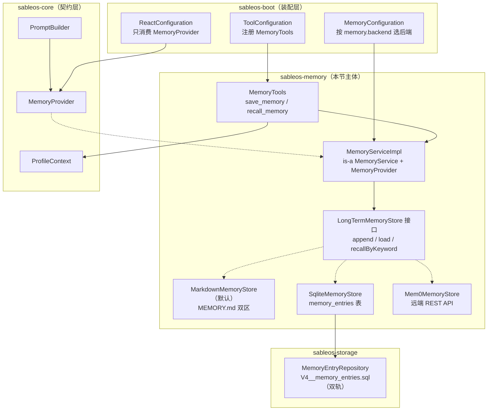
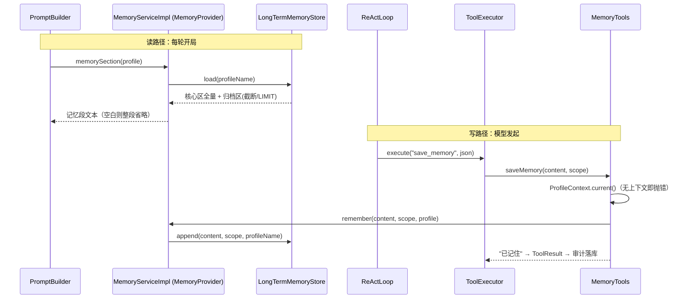

# 第 22 节 Memory 代码走读（新成员版）

> 分支：`006-lesson22-memory`。对应 Spec-Kit 产物：`specs/006-memory-service-backends/`。
> 本文面向第一次接触本仓库的读者：不逐行复述，只讲「改了什么、按什么顺序看、数据怎么流」。

## 1. 本次新增/变更功能概述

本节把 17 节 ReAct 内核预留的**空 MemoryProvider**（`profile -> null`）兑现为真实的长期记忆子系统（FR-006）：`sableos-memory` 模块首次有了实现——一个门面 `MemoryService` + 可插拔后端接口 `LongTermMemoryStore`，自带三种后端（Markdown 文件 / SQLite / Mem0 云服务），并新增两个内置工具 `save_memory` / `recall_memory` 让 Agent 自己读写记忆。记忆按 **Profile 隔离**（同 Profile 的会话共享，跨 Profile 互不干扰），分**核心记忆区**（永不截断）与**归档记忆区**（可截断、可检索）。用户可见的变化：Agent 对话开局 prompt 自动带上该 Profile 的长期记忆；对话中模型可主动调用 `save_memory` 记事、`recall_memory` 检索；通过 `memory.backend` 配置切换存储后端（默认 markdown，落到 `.sableos/<profile>/MEMORY.md`）。

## 2. 关键实现步骤（按阅读顺序）

| # | 环节 | 文件/模块 | 职责 | 必看? |
|---|------|-----------|------|-------|
| 1 | 后端契约 | `sableos-memory/LongTermMemoryStore.java` | 可插拔后端接口：append / load / recallByKeyword 三方法 + **四条行为契约**（不缓存、核心区永不截断、scope 显式指定、recall 只搜归档区） | **必看**（全节枢纽，23 行） |
| 2 | 门面服务 | `sableos-memory/MemoryServiceImpl.java` | 同时实现 `MemoryService`（给工具用）和 core 的 `MemoryProvider`（给 PromptBuilder 用）；把 Session/Profile 对象收敛为 `profileName` 传给后端 | **必看**（48 行，理解双层身份的桥） |
| 3 | 装配入口 | `sableos-boot/MemoryConfiguration.java` | 按 `memory.backend` 条件装配三后端（`@ConditionalOnProperty`，缺省 markdown）；注册唯一 `MemoryProvider` | **必看**（理解全局的入口） |
| 4 | Markdown 后端（默认） | `sableos-memory/store/MarkdownMemoryStore.java` | 按 Profile 分目录的 `MEMORY.md`，`## 核心记忆` / `## 归档记忆` 分区；归档区超 4000 字符截断 | **必看**（默认后端、契约的参照实现） |
| 5 | SQLite 后端 | `sableos-memory/store/SqliteMemoryStore.java` + `sableos-storage/memory/`（Entity/Repository）+ `db/migration/{sqlite,postgresql}/V4__memory_entries.sql` | 记忆按条入库；截断变 `LIMIT 100`、检索变 `LIKE`；表结构走 Flyway 双轨迁移（禁 ddl-auto） | 可略过（同构，知道"契约如何在 SQL 上表达"即可） |
| 6 | Mem0 后端 | `sableos-memory/store/Mem0MemoryStore.java` | 调 Mem0 云服务 REST API；需环境变量 `MEM0_BASE_URL` / `MEM0_API_KEY`，缺了启动即报错点名 | 可略过（远端适配样板） |
| 7 | 记忆工具 | `sableos-memory/tool/MemoryTools.java` | `save_memory` / `recall_memory` 两个 `@Tool`；当前 Profile 取自 `ProfileContext`，无上下文即抛错 | **必看**（60 行，理解 Agent 如何触达记忆） |
| 8 | 既有代码改动 | `boot/react/ReactConfiguration.java`（删 null lambda）、`boot/tool/ToolConfiguration.java`（注册 MemoryTools）、`core/memory/MemoryProvider.java`（注释更新）、`sableos-memory/pom.xml` | `MemoryProvider` bean 改由 MemoryConfiguration 提供，ReactConfiguration 只消费不定义——与 20 节 ToolCatalog 的换装是同一范式 | **必看**：ReactConfiguration 的 diff（理解前向契约如何被替换） |

### 核心代码带读：一个类、两层身份

`MemoryServiceImpl` 是全节最精巧的设计——**同一个 bean 身兼两职**，对内给工具写、对外给 prompt 读，后端对它完全透明：

```java
public class MemoryServiceImpl implements MemoryService, MemoryProvider {
  private final LongTermMemoryStore store;

  @Override // MemoryProvider：PromptBuilder 每轮开局调用
  public String memorySection(Profile profile) {
    return store.load(profile.name()); // 核心区全量 + 归档区截断后
  }

  @Override // MemoryService：save_memory 工具调用
  public void remember(String content, MemoryScope scope, Profile profile) {
    store.append(content, scope, profile.name()); // scope 由调用方显式指定（契约三）
  }
}
```

装配层的取舍也值得看——**唯一 Provider 靠"无第二处定义"保证，刻意不用 `@ConditionalOnMissingBean`**：

```java
@Bean
@ConditionalOnProperty(name = "memory.backend", havingValue = "markdown", matchIfMissing = true)
public LongTermMemoryStore markdownMemoryStore(@Value("${workspace.root:.sableos}") String workspaceRoot) {
  return new MarkdownMemoryStore(Path.of(workspaceRoot)); // 缺省即 markdown，开箱即用
}
```

四条行为契约是跨后端的一致性保证（写进接口 javadoc，契约测试 `MemoryStoreContractTest` 钉死）：①不缓存，每次重新读文件/查库/调 API；②核心记忆区永不被截断；③写 core 还是 archival 由调用方显式 scope 指定；④`recallByKeyword` 只搜归档区。

## 3. 调用链路说明

**读路径（每轮对话自动发生）**：

1. 入口：`AgentService` 驱动 `ReActLoop`，开局由 `PromptBuilder` 拼 system prompt；
2. `PromptBuilder` → `MemoryProvider.memorySection(profile)` → 实际是 `MemoryServiceImpl` → `LongTermMemoryStore.load(profileName)`；
3. 后端按类型取数：Markdown 读 `.sableos/<profile>/MEMORY.md` 分区拼接（归档区超 4000 字符截断）；SQLite 查 `memory_entries`（核心区全量 + 归档区 `LIMIT 100`）；Mem0 调远端 API；
4. 记忆段文本回到 `PromptBuilder`，null/空白则整段省略（FR-006 原有语义不变），否则注入 system prompt 发给 LLM。

**写路径（模型主动发起）**：

1. 模型在 ReAct 循环中请求 `save_memory(content, scope)`；
2. `ToolExecutor` → `AnnotatedToolAdapter`（20 节管道）→ `MemoryTools.saveMemory` → `ProfileContext.current()` 取当前 Profile（无上下文即抛错）→ `MemoryService.remember` → `store.append(content, scope, profileName)`；
3. `recall_memory(keyword)` 同链路，最终只搜归档区（契约四），命中条目拼字符串返回给模型；
4. 工具的成败审计仍走 `ToolExecutor` 既有路径落 `tool_invocations`，本节不开旁路。

**依赖方向**：`boot`（装配）→ `memory`（门面 + 后端 + 工具）→ `core`（`MemoryProvider` 契约）+ `storage`（仅 SqliteMemoryStore 依赖 `MemoryEntryRepository`）。`core` 不依赖 `memory`——契约归 core、实现归 memory，方向干净。

## 4. 架构图与调用图

### 架构图（模块与分层）



**设计取舍**：契约/实现分离——`MemoryProvider` 留在 core（17 节前向契约），实现进 memory 模块，core 零改动（只更新了注释）；后端可插拔用 `@ConditionalOnProperty` 按配置名选择，新增后端只需加一个实现 + 一个 bean 方法；`MemoryServiceImpl` 单类双接口避免了"写服务"与"读 Provider"各建一个对象导致的状态分裂。潜在风险：Markdown 后端整文件读写，归档区很大时每次 load/append 都是全量 IO；Mem0 后端把记忆数据送出本机，与"私有可审计"定位存在张力，适合自愿接入的场景。

### 调用图（方法级）



**要点**：两条路径在 `MemoryServiceImpl` 汇合，后端无感知；scope 解析失败（非 core/archival）在工具层就抛错，不会带着脏数据进后端；审计仍由 ToolExecutor 统一收口。

## 5. 遗留问题与注意事项

1. **Markdown 后端全量 IO**：每次 `append`/`load` 都整文件读重写，归档区条目很多时是 O(n) 文件操作；核心阶段可接受，量大后建议索引化或直接用 sqlite 后端。
2. **并发写无保护**：Markdown 后端读-改-写非原子，同 Profile 两个会话同时 `save_memory` 可能丢更新（单进程内可用锁，跨进程需文件锁）——当前 ReAct 单会话串行，风险低，但值得知晓。
3. **Mem0 后端的隐私张力**：记忆数据出本机，与项目"私有可审计"定位冲突，文档中已标注为可选接入；企业部署默认不应开启。
4. **mem0 配置走环境变量**：`MEM0_BASE_URL` / `MEM0_API_KEY` 读 `System.getenv`，未进 `application.yaml` 配置体系，与仓库其他配置的的一致性待统一。
5. **SQLite 检索是 `LIKE %kw%`**：无分词、无相关性排序，中文关键词尚可，复杂检索需求归后续（向量/FTS）。
6. **`workspace.root` 缺省 `.sableos`**：相对路径，以进程工作目录为基准——以 fat JAR 在不同目录启动会读到不同的记忆文件，部署时注意固定工作目录。
7. **无遗忘/衰减机制**：归档区只增不减（超出部分仅展示时截断，数据仍在），记忆治理（过期、摘要压缩）未在本节范围。
